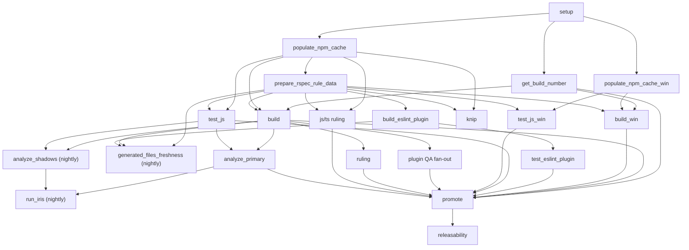
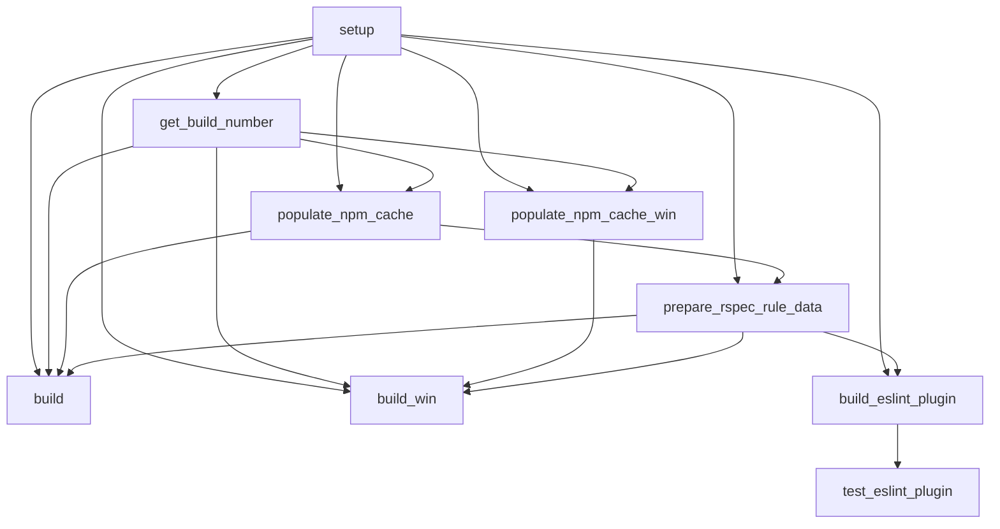
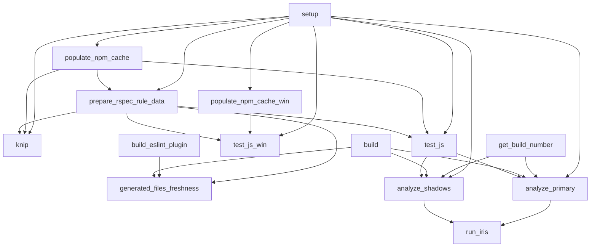
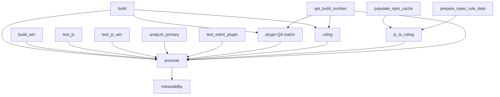

# SonarJS CI Reference

This document explains the main GitHub Actions pipeline in
[`../.github/workflows/build.yml`](../.github/workflows/build.yml).

Explicit caches in `build.yml`, `orchestrator-cache`, and `rule-api-cache` use the
released `SonarSource/gh-action_cache` action. S3 also carries the two large
build outputs: locally built SonarJS Maven packages and Maven target directories.
Smaller reports, RSPEC data, ESLint outputs, and ruling-bot artifacts stay on
GitHub Artifacts. External actions, including mise, retain their own caching.

This is the document to read first when you need to answer any of these questions quickly:

- Which jobs exist and why?
- Which jobs depend on which other jobs?
- What data moves via outputs, caches, and artifacts?
- What is shared across jobs in one run?
- What is shared from the default branch to other branches?
- Where does S3 still appear, and where does it not?
- How do Repox, Vault, RSPEC, SonarQube, and promotion fit into the pipeline?

## Scope

This document focuses on the main `Build` workflow:

- [`../.github/workflows/build.yml`](../.github/workflows/build.yml)
- [`../.github/actions/ruling_bot/action.yml`](../.github/actions/ruling_bot/action.yml)
- [`../.github/actions/orchestrator-cache/action.yml`](../.github/actions/orchestrator-cache/action.yml)
- [`../.github/actions/rule-api-cache/action.yml`](../.github/actions/rule-api-cache/action.yml)

Other workflows exist in `.github/workflows/`, but they are out of scope unless they directly affect the `build.yml` lifecycle. The exception is [`../mise.toml`](../mise.toml), which is in scope: it is the single declared source of the Java/Maven/Node versions `build.yml` provisions — see [Toolchain Provisioning (mise)](#toolchain-provisioning-mise).

## Cache And Artifact Model

The workflow uses the shared Sonar cache action with `backend: s3` and
`import-github-cache: false`. The first run with a new key populates S3 directly.
Ordinary cache calls restore first and save after a successful job when needed;
there are no SonarJS restore-only or lookup-only variants.

Merge-queue refs cannot write S3 with the released action. On `merge_group`,
explicit caches select its GitHub backend and large outputs use GitHub Artifacts.
This also lets npm producer jobs publish newly installed dependencies for consumers
in that queue run. External actions' cache behavior is independent of this choice.

Maven and npm registry configuration keeps its existing `disable-caching` inputs.
Orchestrator and Rule API cache selection stays centralized in the local actions.

## Trigger Model And Global Controls

`build.yml` runs on:

- `push` to `master`
- `push` to `branch-*`
- `push` to `dogfood-*`
- `pull_request`
- `merge_group`
- `workflow_dispatch`
- nightly `schedule`

Global behavior:

- `concurrency.group = ${{ github.workflow }}-${{ github.event.pull_request.number || github.ref }}`
- `cancel-in-progress: true`

That means:

- one PR gets at most one active `Build` run
- one branch ref gets at most one active `Build` run
- new pushes cancel older in-flight runs for the same PR/ref

## Runner Strategy

Runner labels express relative size and environment, not a stable hardware contract. The workflow uses them as follows:

| Runner label                                  | Typical jobs                                                                                                                 | Why it is used                                                                 |
| --------------------------------------------- | ---------------------------------------------------------------------------------------------------------------------------- | ------------------------------------------------------------------------------ |
| `sonar-xs`                                    | `setup`, `get_build_number`, `populate_npm_cache`, `prepare_rspec_rule_data`, `knip`, `promote`, `releasability`, `run_iris` | Lightweight orchestration, metadata, cache preparation, and control-plane jobs |
| `sonar-m`                                     | `test_js`, `analyze_primary`, `analyze_shadows`, most Linux plugin QA jobs                                                   | Medium Linux compute for tests and analysis                                    |
| `sonar-l`                                     | `build`                                                                                                                      | Main Linux Maven build and deploy                                              |
| `sonar-xl`                                    | `js_ts_ruling`, `js_ts_ruling_update`, `ruling`                                                                              | Large ruling workloads and result updates                                      |
| `github-ubuntu-latest-s`                      | `build_eslint_plugin`, `test_eslint_plugin`, `generated_files_freshness`                                                     | Small GitHub-hosted Linux jobs                                                 |
| `github-windows-latest-s`                     | `populate_npm_cache_win`                                                                                                     | Small Windows cache producer                                                   |
| `github-windows-latest-m`                     | `build_win`, `test_js_win`, Windows plugin QA jobs                                                                           | Medium Windows build/test jobs                                                 |
| `warp-custom-ubuntu-24-04` + Alpine container | Alpine QA jobs                                                                                                               | Host runner plus containerized musl/Alpine validation                          |
| `warp-custom-ubuntu-24-04` + Ubuntu container | `minimal_ubuntu_analyzer_check`                                                                                              | Optional single-analysis check in minimal `ubuntu:24.04`                       |

## High-Level Pipeline Map



## Detailed Dependency Views

The full 31-job dependency graph is too dense to read well as a single Mermaid diagram. The grouped views below are the readable version; the job table that follows is the exact exhaustive reference.

### 1. Setup And Artifact Producers



### 2. Verification And Analysis



### 3. QA, Ruling, And Release Fan-In



## SQ-IDE QA API

The SonarLint integration tests inherit the usual SonarJS build configuration. The analyzer's
`sonar-plugin-api` dependency management is scoped to `sonar-plugin/pom.xml`, so it does not
override the API supplied transitively by SonarLint Core. Test plugins and fast tests that
compile against the analyzer API declare that version explicitly. Other shared dependency
management still applies to the integration tests.

The SonarLint suite includes a dedicated runtime test that checks the loaded API version against
Core's published POM and logs its JAR location. Keep API dependency management out of the root
POM and the `its/**` parent POMs; it belongs in `sonar-plugin/pom.xml` so Core upgrades continue
to select their own API version.

After building the plugin locally, run:

```shell
mvn -f its/plugin/sonarlint-tests/pom.xml -DskipTests=false verify
```

Local runs discover the built JAR in `sonar-plugin/sonar-javascript-plugin/target`. In CI,
`SONARSOURCE_QA=true` activates the existing Maven copy step, which uses the inherited project
version to populate that directory from the downloaded Maven artifacts. The plugin ships a
single classifier-less JAR; its embedded Node.js runtime is fetched on demand from the
`sonar-javascript-plugin-zip-<version>.zip` resources artifact (see
[`On-demand resources ZIP`](BUILD.md#on-demand-resources-zip-js-2714--sc-49784) in `BUILD.md`),
so the without-Node CI jobs no longer need to select a classifier to test that path.

## Optional minimal Ubuntu verification

`minimal_ubuntu_analyzer_check` runs on non-fork pull requests and all non-PR workflow runs
(pushes, merge queues, nightly schedules, and manual runs) after the final SonarJS artifacts
are built. Like the other artifact QA jobs, it requires internal build credentials,
so fork pull requests skip it. It uses `warp-custom-ubuntu-24-04` with a digest-pinned `ubuntu:24.04`
container, installs only bootstrap tools and Java/Maven, and verifies that no system Node is
available before analysis. The analysis checks compatibility with the minimal OS environment
without making assumptions about specific system-library dependencies.
The WarpBuild runner hosts Docker; the analyzer runs inside the Ubuntu container, whose
libraries are isolated from the host. This follows the [runner policy](https://xtranet-sonarsource.atlassian.net/wiki/spaces/Platform/pages/3694231566)
for Docker jobs. The [sidecar runner approach](https://xtranet-sonarsource.atlassian.net/wiki/spaces/Platform/pages/4403003406)
is intended for service containers and requires consultation for custom job images; this
check needs no service containers.

The job runs only `EmbeddedNodeTest`, which analyzes a small JavaScript project with the final
Linux x64 plugin and asserts successful use of the embedded Node runtime without analyzer errors.
It uses the scanner integration tester rather than starting a full SonarQube server, so it does
not need a dedicated Unix user or the consumer test plugins. `continue-on-error: true` keeps
failures non-blocking; the job is excluded from promotion and failure-notification dependencies.
The existing full/fast QA jobs keep their original runners and behavior.

## Job Index

| Job                                  | Runner                     | Needs                                                                            | Condition                                                             |
| ------------------------------------ | -------------------------- | -------------------------------------------------------------------------------- | --------------------------------------------------------------------- |
| `setup`                              | `sonar-xs`                 | `-`                                                                              | default                                                               |
| `get_build_number`                   | `sonar-xs`                 | `setup`                                                                          | non-fork PRs and all non-PR runs                                      |
| `populate_npm_cache`                 | `sonar-xs`                 | `setup`, `get_build_number`                                                      | non-fork PRs and all non-PR runs                                      |
| `populate_npm_cache_win`             | `github-windows-latest-s`  | `setup`, `get_build_number`                                                      | non-fork PRs and all non-PR runs                                      |
| `prepare_rspec_rule_data`            | `sonar-xs`                 | `setup`, `populate_npm_cache`                                                    | non-fork PRs and all non-PR runs                                      |
| `build`                              | `sonar-l`                  | `setup`, `get_build_number`, `populate_npm_cache`, `prepare_rspec_rule_data`     | non-fork PRs and all non-PR runs                                      |
| `build_win`                          | `github-windows-latest-m`  | `setup`, `get_build_number`, `populate_npm_cache_win`, `prepare_rspec_rule_data` | non-fork PRs and all non-PR runs                                      |
| `build_eslint_plugin`                | `github-ubuntu-latest-s`   | `setup`, `prepare_rspec_rule_data`                                               | non-fork PRs and all non-PR runs                                      |
| `generated_files_freshness`          | `github-ubuntu-latest-s`   | `prepare_rspec_rule_data`, `build_eslint_plugin`, `build`                        | nightly only                                                          |
| `test_eslint_plugin`                 | `github-ubuntu-latest-s`   | `setup`, `build_eslint_plugin`                                                   | default                                                               |
| `knip`                               | `sonar-xs`                 | `setup`, `populate_npm_cache`, `prepare_rspec_rule_data`                         | default                                                               |
| `test_js`                            | `sonar-m`                  | `setup`, `populate_npm_cache`, `prepare_rspec_rule_data`                         | default                                                               |
| `test_js_win`                        | `github-windows-latest-m`  | `setup`, `populate_npm_cache_win`, `prepare_rspec_rule_data`                     | default                                                               |
| `analyze_primary`                    | `sonar-m`                  | `setup`, `get_build_number`, `test_js`, `build`                                  | non-fork PRs and all non-PR runs                                      |
| `analyze_shadows`                    | `sonar-m`                  | `setup`, `get_build_number`, `test_js`, `build`                                  | nightly only                                                          |
| `plugin_qa_with_node`                | `sonar-m`                  | `setup`, `get_build_number`, `build`                                             | non-fork PRs and all non-PR runs                                      |
| `plugin_qa_fast_with_node`           | `sonar-m`                  | `setup`, `get_build_number`, `build`                                             | non-fork PRs and all non-PR runs                                      |
| `plugin_qa_without_node`             | `sonar-m`                  | `setup`, `get_build_number`, `build`                                             | non-fork PRs and all non-PR runs                                      |
| `plugin_qa_without_node_dev`         | `sonar-m`                  | `setup`, `get_build_number`, `build`                                             | nightly only                                                          |
| `minimal_ubuntu_analyzer_check`      | `warp-custom-ubuntu-24-04` | `setup`, `get_build_number`, `build`                                             | non-fork PRs and all non-PR runs; non-blocking                        |
| `plugin_qa_without_node_alpine`      | `warp-custom-ubuntu-24-04` | `setup`, `get_build_number`, `build`                                             | nightly only                                                          |
| `plugin_qa_fast_without_node`        | `sonar-m`                  | `setup`, `get_build_number`, `build`                                             | non-fork PRs and all non-PR runs                                      |
| `plugin_qa_fast_without_node_dev`    | `sonar-m`                  | `setup`, `get_build_number`, `build`                                             | nightly only                                                          |
| `plugin_qa_fast_without_node_alpine` | `warp-custom-ubuntu-24-04` | `setup`, `get_build_number`, `build`                                             | nightly only                                                          |
| `plugin_qa_win`                      | `github-windows-latest-m`  | `setup`, `get_build_number`, `build`                                             | non-fork PRs and all non-PR runs                                      |
| `plugin_qa_sonarlint_win`            | `github-windows-latest-m`  | `setup`, `get_build_number`, `build`                                             | non-fork PRs and all non-PR runs                                      |
| `plugin_qa_win_fast_with_node`       | `github-windows-latest-m`  | `setup`, `get_build_number`, `build`                                             | non-fork PRs and all non-PR runs                                      |
| `js_ts_ruling`                       | `sonar-xl`                 | `setup`, `populate_npm_cache`, `prepare_rspec_rule_data`                         | non-fork PRs and all non-PR runs                                      |
| `js_ts_ruling_update`                | `sonar-xl`                 | `js_ts_ruling`                                                                   | non-fork PRs and default branch when JS/TS ruling ran                 |
| `ruling`                             | `sonar-xl`                 | `setup`, `get_build_number`, `build`                                             | non-fork PRs and all non-PR runs                                      |
| `run_iris`                           | `sonar-xs`                 | `analyze_primary`, `analyze_shadows`                                             | nightly only                                                          |
| `promote`                            | `sonar-xs`                 | many fan-in jobs                                                                 | only when upstream jobs succeeded and the run is allowed to promote   |
| `releasability`                      | `sonar-xs`                 | `promote`                                                                        | only after successful promote on `master`, `branch-*`, or `dogfood-*` |

## Control-Plane Handoff

These are the small data items passed as job outputs or step outputs, not bulky file payloads.

| Producer                  | Data                | Consumers                                                   | Meaning                                                                                        |
| ------------------------- | ------------------- | ----------------------------------------------------------- | ---------------------------------------------------------------------------------------------- |
| `setup`                   | `node-matrix`       | Node-matrix plugin QA jobs                                  | Derived from `package.json` engine range                                                       |
| `setup`                   | `js-files-hash`     | `test_js`, `test_js_win`                                    | Cache key seed for JS coverage and Windows JS marker, including workflow and dependency inputs |
| `prepare_rspec_rule_data` | `test-input-hash`   | `test_js`, `test_js_win`                                    | Digest of refreshed JS and CSS rule resources used to invalidate test skip caches              |
| `setup`                   | `maven-hash`        | all Maven cache users                                       | Cache key seed for Maven dependencies                                                          |
| `setup`                   | `npm-hash`          | all `node_modules` producers/consumers                      | Exact cache key seed for installed Node dependencies                                           |
| `setup`                   | `cache-month`       | Maven cache steps                                           | Monthly key rotation value                                                                     |
| `setup`                   | `is-default-branch` | most `mise-action` calls                                    | Controls when tool caches may be saved                                                         |
| `get_build_number`        | `build-number`      | build, QA, analysis, promotion, and shared env anchor users | One build number is minted once and reused consistently                                        |
| `config-maven`            | `project-version`   | `analyze_primary`, `analyze_shadows`                        | Sonar analysis version value                                                                   |

### Important internal detail: build number cache

`SonarSource/ci-github-actions/get-build-number` itself uses GitHub cache internally:

- restore: `build-number-${github.run_id}`
- save: same key
- purpose: rerun stability within one workflow run

That cache is tiny, but it is still part of the repository's GitHub cache footprint.

## File-Plane Handoff Inside One Workflow Run

Small payloads use GitHub Artifacts. Large build outputs use S3 entries keyed by
`github.run_id` and the producing `build` job's `github.run_attempt`. Consumers use
`needs.build.outputs.storage-key`, so a consumer-only retry keeps the original
producer's key. Default-branch fallback and GitHub cache import are disabled for
these entries, and consumers fail on a cache miss. Rerun the producer if an entry
has expired or its post-job upload failed.

### GitHub artifacts

The two large `build` outputs below use GitHub Artifacts only on merge queues.
Other rows continue using GitHub Artifacts on every applicable event.

| Producer                  | Artifact name                       | Consumers                                                                                                                  | Purpose                                                                           | Retention                         |
| ------------------------- | ----------------------------------- | -------------------------------------------------------------------------------------------------------------------------- | --------------------------------------------------------------------------------- | --------------------------------- |
| `prepare_rspec_rule_data` | `rspec-rule-data-${github.sha}`     | `build`, `build_win`, `build_eslint_plugin`, `generated_files_freshness`, `knip`, `test_js`, `test_js_win`, `js_ts_ruling` | One RSPEC refresh per run; downstream jobs do not refresh again                   | 1 day                             |
| `build`                   | `sonarjs-m2`                        | all plugin QA jobs, `ruling`                                                                                               | Share locally built SonarJS Maven artifacts instead of rebuilding them everywhere | 1 day                             |
| `build`                   | `maven-targets-${github.sha}`       | `analyze_primary`, `analyze_shadows`                                                                                       | Reuse compiled Maven outputs for Sonar analysis                                   | 1 day                             |
| `build`                   | `jacoco-xml-reports-${github.sha}`  | `analyze_primary`, `analyze_shadows`                                                                                       | Reuse JaCoCo XML coverage reports                                                 | 1 day                             |
| `build`                   | `generated-licenses-${github.sha}`  | `generated_files_freshness`                                                                                                | Reuse the dependency licenses packaged by the nightly build                       | 1 day                             |
| `build_eslint_plugin`     | `eslint-tarball-${github.sha}`      | `test_eslint_plugin`                                                                                                       | Same-run ESLint plugin tarball handoff                                            | 1 day                             |
| `build_eslint_plugin`     | `generated-readmes-${github.sha}`   | `generated_files_freshness`                                                                                                | Reuse the README files produced by the nightly ESLint build                       | 1 day                             |
| `test_js`                 | `js-coverage-reports-${github.sha}` | `analyze_primary`, `analyze_shadows`                                                                                       | Reuse JS coverage reports for Sonar analysis                                      | 1 day                             |
| `ruling`                  | `ruling-differences`                | humans only on failure                                                                                                     | Failure triage artifact                                                           | default retention for upload step |

### Why ESLint Outputs Are Artifacts, Not Caches

The ESLint plugin tarball and generated READMEs are purely same-run handoffs:

- producer: `build_eslint_plugin`
- consumers: `test_eslint_plugin` for the tarball and nightly `generated_files_freshness` for the READMEs
- no reuse across workflow runs is needed
- stale cross-run reuse would be actively misleading

That is exactly artifact semantics, not cache semantics.

## Cross-Run State: Caches

### Explicit workflow-owned caches

| Cache                      | Path                                                     | Key                                           | Policy                                                                                                  |
| -------------------------- | -------------------------------------------------------- | --------------------------------------------- | ------------------------------------------------------------------------------------------------------- |
| Installed NPM dependencies | `node_modules`                                           | `npm-${runner.os}-${npm-hash}`                | Producer restores normally; installs on a non-exact hit. Consumers fail on a miss.                      |
| CycloneDX CLI              | `~/.cache/cyclonedx-cli`                                 | OS, architecture, installer script hash       | Restore/save in Linux and Windows builds.                                                               |
| JS coverage                | `coverage/js`                                            | OS, JS input hash, generated RSPEC input hash | Exact hits skip tests; reports are still validated and uploaded.                                        |
| Windows JS marker          | `.js-test-marker-win`                                    | OS, JS input hash, generated RSPEC input hash | Restore/save a success marker; exact hits skip tests.                                                   |
| Maven dependencies         | `~/.m2/repository` (reactor outputs removed before save) | OS, month, Maven input hash                   | All callers use restore/save with a monthly restore prefix.                                             |
| Orchestrator distributions | Workspace `orchestrator` directory                       | Prefix, month, run ID                         | Eligible jobs restore/save with a monthly prefix. PRs and disabled jobs use an uncached temporary home. |
| Rule API clone             | `$HOME/.sonar/rule-api`                                  | Prefix, run ID                                | Restore/save with a stable prefix.                                                                      |

### Helper-owned or transitive caches

| Owner                     | Path or payload        | Backend                       | Why it exists                                                                                                                                                                         |
| ------------------------- | ---------------------- | ----------------------------- | ------------------------------------------------------------------------------------------------------------------------------------------------------------------------------------- |
| `get-build-number` action | `.build_number.txt`    | GitHub cache                  | Reuse one build number across reruns of the same workflow run                                                                                                                         |
| `jdx/mise-action`         | tool/runtime downloads | action-managed cache behavior | Reuses provisioned Java/Maven/Node toolchains; mostly action-managed, but a few jobs pass an explicit `cache_key` — see [Toolchain Provisioning (mise)](#toolchain-provisioning-mise) |

### Cache policies

Every Maven cache caller removes `~/.m2/repository/org/sonarsource/javascript`
after its work, before cache post-job saves. Locally built packages travel
separately, so downstream jobs can save missing dependency caches without adding
run-specific reactor outputs.

Orchestrator and Rule API use rolling keys because their downloads evolve
independently of the SonarJS tree. The wrappers no longer expose `save` ownership:
all eligible callers use the released action's normal restore/save behavior.
PR Orchestrator runs still skip both restore and save to exercise production
authentication with fresh downloads. Nightly DEV jobs remain uncached.

The shared action scopes S3 keys by branch and can fall back to the default
branch for reusable dependency caches. A fallback restore can report
`cache-hit: false`, so npm producers or JS test jobs may repeat work despite
restoring usable default-branch content. This is an accepted simplification.
There is no promotion of a branch cache back to the default branch.

Before skipping installation or tests, the workflow requires both an exact cache
hit and the expected restored files: npm's hidden `node_modules/.package-lock.json`,
both JS coverage reports, or the Windows test success marker. The released shared
action can report a successful existence probe after a failed restore. Missing
files therefore trigger normal installation or testing instead of trusting that
probe. These checks detect missing payloads; they do not validate every dependency
file or replace successful-restore reporting in the shared action.

## S3 Build Output Handoffs

| Payload                | S3 key                                        | Archive paths                         | Consumers                       |
| ---------------------- | --------------------------------------------- | ------------------------------------- | ------------------------------- |
| Built SonarJS packages | `sonarjs-m2-${run_id}-${producer_attempt}`    | `.ci-sonarjs-m2`                      | Plugin QA and Maven ruling jobs |
| Maven targets          | `maven-targets-${run_id}-${producer_attempt}` | `**/target/` (including site reports) | Primary and shadow analyses     |

SonarJS packages are copied into a workspace-relative staging directory before
publication. Consumers restore that directory and copy its contents into their
own Maven repository. `enableCrossOsArchive: true` supports Linux-to-Windows
handoff without depending on different runner home paths. Producer and consumer
path inputs must match. Minimal Ubuntu installs `jq` and `zstd`; Alpine also
installs GNU tar for compatible cache archives. Windows consumers download a
checksum-pinned zstd binary and add it only to the SonarJS restore step's PATH.
The shared cache action includes compression in its cache version: a Windows
gzip lookup cannot find the Linux zstd entry, even with cross-OS archives enabled.
Keeping this PATH local preserves external actions' compression and caching.

The S3 target archive includes complete target directories, accepting some extra
report files to avoid custom packaging. These are ordinary caches: uploads happen in post-job steps, upload failures can
be warnings, and retention follows the shared S3 bucket lifecycle rather than
the former one-day artifact setting. There is no artifact
listing, digest contract, write-once guarantee, or PR-close deletion for S3 entries.
A successful producer is therefore not a strict publication guarantee; required
consumers enforce presence. Both output entries disable default-branch fallback.
Merge queues retain the original GitHub artifact transfers.

Small reports, prepared RSPEC resources, ESLint outputs, generated files, and all
ruling-bot outputs and filesystem snapshots retain GitHub artifact behavior.
`pr-cleanup.yml` continues cleaning GitHub storage only. Mise, build-number caching,
and other external actions' internal caches are outside this migration.

## Job-By-Job Walkthrough

### Foundation and dependency preparation

#### `setup`

Responsibilities:

- derive Node matrix from `package.json`
- hash JavaScript sources plus test-environment inputs for JS test reuse
- hash Maven files for Maven cache
- hash lockfile plus patches for `node_modules` cache
- compute cache month
- expose whether this is the default branch

This job is the control-plane root of the workflow.

#### `get_build_number`

Responsibilities:

- mint or recover a single build number
- make that value available to later jobs

This prevents downstream jobs from inventing inconsistent build numbers.

#### `populate_npm_cache` / `populate_npm_cache_win`

Responsibilities:

- probe the exact `node_modules` cache
- if present, stop early
- if missing, install dependencies and let the post step save the cache

Platform specifics:

- Linux runs `config-npm@v2` to fetch an Edge token from Vault and configure npm
- Windows fetches an Edge token from Vault and configures npm with `npm config set`
- Linux and Windows still produce separate `node_modules` caches because the cache key includes `runner.os`

#### `prepare_rspec_rule_data`

Responsibilities:

- restore `node_modules`
- restore Maven cache
- restore rule-api cache
- authenticate to RSPEC through Vault-fetched GitHub token
- run `npm run rspec:refresh`
- upload refreshed rule JSON and `rspec.sha` files as an artifact

This is the only job in the pipeline that refreshes RSPEC.

### Core build and correctness jobs

#### `build`

Responsibilities:

- restore `node_modules`
- restore Maven cache
- restore the checksum-verified CycloneDX CLI cache
- download refreshed RSPEC files
- configure Maven/Repox
- fetch deploy/signing credentials
- regenerate NPM dependency licenses before the bridge is packed
- run Maven deploy with license-header validation, Maven dependency-license regeneration, and the coverage/sign/release/`sbom` profiles
- share SonarJS packages and Maven targets through S3 (GitHub Artifacts on merge queues)
- upload JaCoCo XML reports and, on nightly runs, generated dependency licenses

This is the central build producer job.

#### `build_win`

Responsibilities:

- Windows verification build
- restores `node_modules`, CycloneDX CLI cache, and RSPEC artifact; restores the Maven cache and, on the default branch, also saves it
- runs `mvn verify -Psbom -T1C`

It validates Windows buildability but does not deploy artifacts.

#### `build_eslint_plugin`

Responsibilities:

- restore `node_modules`
- configure npm registry
- download refreshed RSPEC data
- build ESLint plugin package
- upload tarball artifact
- on nightly runs, update rule counts and upload both generated README files

#### `generated_files_freshness`

Nightly-only maintenance job:

- downloads refreshed RSPEC data
- downloads the README files generated by `build_eslint_plugin`
- downloads the dependency license trees generated and packaged by `build`
- opens or updates a bot PR if generated content drifted

#### `knip`

Responsibilities:

- restore `node_modules`
- download refreshed RSPEC data
- run `npm run bbf`
- run `npx knip`

#### `test_js`

Responsibilities:

- use `coverage/js` cache as a skip mechanism
- on miss, restore `node_modules`, download refreshed RSPEC data, generate metadata, compile bridge, run JS tests with coverage
- validate coverage files exist
- upload coverage reports artifact for analysis jobs

This job is both a cache consumer and a cache producer.
Its skip cache is keyed on source, workflow, and dependency inputs, plus a digest of the refreshed RSPEC rule resources. Changes to generated test inputs therefore cannot silently reuse stale success.

#### `test_js_win`

Responsibilities:

- use a Windows marker cache as a skip mechanism
- on miss, restore `node_modules`, download refreshed RSPEC data, generate metadata, compile bridge, run JS tests
- create marker directory so the post step can save it

Like `test_js`, its skip key includes workflow and dependency inputs and the refreshed RSPEC rule-resource digest in addition to source inputs.

### Analysis, QA, and ruling fan-out

#### `analyze_primary`

Responsibilities:

- wait for `build` and `test_js`
- restore `node_modules` and Maven cache
- download JS coverage reports, Maven targets, and JaCoCo XML
- configure Maven
- fetch SonarQube Next credentials from Vault
- run Maven Sonar analysis

#### `analyze_shadows`

Nightly-only twin of `analyze_primary`:

- runs against shadow platforms
- matrix includes SonarCloud EU and SonarQube US

#### Plugin QA family

These jobs all consume:

- SonarJS packages from `build` (S3, or GitHub Artifacts on merge queues)
- Maven cache
- often orchestrator cache
- various licenses and runtime credentials

Variants differ by:

- Node present vs disabled
- normal vs `fast`
- Linux vs Windows vs Alpine
- `LATEST_RELEASE` vs nightly `DEV`

Important details:

- Alpine jobs pre-seed `BUILD_NUMBER` from `get_build_number` because the `get-build-number` action's GitHub cache approach is unreliable in Alpine-container context
- `fast` jobs use `key-prefix: orchestrator-production-fast`
- `DEV` jobs intentionally skip orchestrator cache because the target version changes too frequently

#### `js_ts_ruling`

Responsibilities:

- checkout the tested tree with submodules and depth two; capture the PR merge's first parent
- restore `node_modules`
- download refreshed RSPEC data
- run JS/TS ruling
- save generated results when ruling fails; expose the ruling outcome, successful persistence,
  tested base and exact producing artifact name to `js_ts_ruling_update`

The ruling job fails when expected results differ. `js_ts_ruling_update` persists an owned fix
before requesting an independent report; a passing ruling run cleans up obsolete fixes and
refreshes the original PR report. The reporter runs the bot and reads data from the exact tested
checkout. The updater is a dependency of promotion and protected-branch failure notification.

The [ruling bot README](../.github/actions/ruling_bot/README.md) is the maintained behavior and
design contract. It owns expected outcomes, tested merge/fix ancestry, freshness and ownership,
races and corner cases, historical decisions, configuration ownership and duplication rules,
and the regression checklist for future PRs. Keep those policies there; this section describes
how to operate and retry the SonarJS workflow.

The updater and reporter load SonarJS settings from `.github/ruling-bot.config.mjs` in the exact
tested checkout. Action/dispatch inputs override those settings when required; omitted inputs
inherit them. Build passes only the dynamic artifact name, and the reporter workflow passes
`toJSON(inputs)` so explicit overrides, including empty values, survive the handoff.
When changing canonical configuration
or provenance definitions, regenerate their consumers and the retry command below with
`node .github/actions/ruling_bot/generate-config.mjs`, then verify with `--check`.
The producing ruling job's exact artifact name is exposed as an output and reused by upload,
updater download and dispatch. Preserve it separately from the current Build attempt when retrying.

Report retries require a tested commit containing the current reporter action and input contract.
For Builds predating their introduction, rebase the original PR branch and rerun ruling first;
changing the artifact name cannot supply bot code missing from the tested commit.
For a supported Build, retry the existing report with all its original inputs using
`gh run rerun <report-run-id>`. To
request a new report with the same tested bot code, use the originating Build ID and its current
attempt, exact merge and first-parent SHAs, and any explicit configuration overrides used by the
original Build. For example:

<!-- BEGIN GENERATED RETRY COMMAND -->

```sh
gh workflow run ruling-diff-comment.yml --ref '<original-branch>' \
  -f 'pr-number=<original-pr-number>' \
  -f 'base-sha=<tested-merge-first-parent-sha>' \
  -f 'head-sha=<tested-merge-sha>' \
  -f 'run-id=<build-run-id>' \
  -f 'run-attempt=<current-build-run-attempt>' \
  -f ruling-failed=true \
  -f is-pull-request=true \
  -f 'fix-pr-url=<fix-pr-url>' \
  -f 'target-ref=<original-branch>' \
  -f 'results-artifact-name=actual_js_ts-<producing-ruling-job-attempt>'
```

<!-- END GENERATED RETRY COMMAND -->

For a passing Build report, retain its `run-id`/`run-attempt` and omit `ruling-failed`/`fix-pr-url`.
For a default-branch failed run, use the fix PR number as `pr-number`, pass the tested branch commit
for both SHAs, set `target-ref=master`, and omit `is-pull-request=true`.
Preserve the producing ruling job's artifact name even if the Build's current
attempt is newer: after rerunning only the updater, `run-attempt=2` can still require
`results-artifact-name=actual_js_ts-1`. Omitted configuration is reconstructed from the tested
commit's module and generic defaults. Forward the original explicit overrides as well; a different
reporter ref or a newer master does not change the tested configuration. See the README's
[configuration and reuse contract](../.github/actions/ruling_bot/README.md#configuration-and-reuse)
for custom modules, direct action inputs, and explicit empty opt-outs.
A stale retry skips mutations; missing artifacts or unavailable tested commits fail visibly.

`ruling-fix-cleanup.yml` handles original-PR closure/merge independently of the PR cache/artifact
cleanup workflow. Its trusted checkout and ownership/race rules are documented in the
[ruling bot contract](../.github/actions/ruling_bot/README.md#closing-and-merging-the-original-pr).

#### `ruling`

Responsibilities:

- checkout with submodules
- restore Maven cache
- restore the SonarJS packages produced by `build`
- configure Maven
- restore the normal Orchestrator cache
- run Maven ruling tests with explicit parallelism cap
- upload `ruling-differences` on failure

This job can restore and save a recent Orchestrator baseline outside pull requests.

### Finalization

#### `run_iris`

Nightly-only post-analysis comparison:

- runs only after primary and shadow analyses
- compares Next against shadow platforms through the dedicated IRIS action

#### `promote`

This is the main fan-in gate.

It waits for:

- build
- Windows build
- JS tests
- Windows JS tests
- primary analysis
- ESLint plugin tests
- Linux/Windows/Alpine plugin QA jobs
- ruling jobs
- build-number generation

Then it runs `SonarSource/ci-github-actions/promote@v2`, which promotes build info/artifacts in Repox.

#### `releasability`

Final branch-level status job:

- runs only after successful promote
- only on `master`, `branch-*`, and `dogfood-*`
- computes releasability state and updates GitHub commit status

## Repox, Vault, RSPEC, Sonar Platforms, And Other External Systems

### Repox / Artifactory

Repox is the repository manager behind both npm and Maven flows here.

#### npm

`populate_npm_cache` runs `config-npm`, which defaults to the production Edge `https://repox.sonar.build` on self-hosted runners. It:

- fetches a `private-reader` token issued by the Edge (`development/artifactory-edge-prod` on `https://vault.sonar.build`)
- points `npm` at `https://repox.sonar.build/artifactory/api/npm/npm`
- fetches npmjs lockfile tarballs through Edge at install time. The workflow sets `NPM_CONFIG_REPLACE_REGISTRY_HOST=npmjs`, so npm replaces the public registry host with the configured Edge registry on Linux and Windows.

The committed root `package-lock.json` uses `https://registry.npmjs.org/` for public dependencies. Keep new entries on npmjs, including when resolving lockfile conflicts. `.npmrc` keeps the public npm defaults, and both the npm configuration and npm datasource overrides in `.github/renovate.json` use npmjs. Public source installations therefore need no SonarSource credentials or internal registry access.

`populate_npm_cache_win` cannot run `config-npm` because mise has no jfrog-cli backend on Windows. It fetches the same Edge `private-reader` token from Vault and sets the npm registry with `npm config set`.

The ESLint plugin build (extra `builtin-modules` install) and the ESLint plugin tests (no lockfile) run the same `config-npm` step. Its root `package.json` version rewrite doesn't affect the plugin tarball, whose version comes from `.pmgrc.toml`.

The ESLint plugin release runs on a GitHub-hosted runner. `jfrog rt npm-config` selects the SaaS registry for `jfrog rt npm-ci`; npm's default `replace-registry-host=npmjs` redirects the public lockfile URLs to that registry. Publish and promote (`jfrog rt npm-publish`) stay on SaaS. This workflow does not require Edge access.

#### Maven

`config-maven` defaults to the production Edge `https://repox.sonar.build` on self-hosted runners. It:

- fetches a `private-reader` token issued by the Edge (`development/artifactory-edge-prod` on `https://vault.sonar.build`)
- writes Maven `settings.xml`
- sets `ARTIFACTORY_URL` to the Edge and `SONARSOURCE_REPOSITORY_URL=$ARTIFACTORY_URL/sonarsource-qa`
- exports authentication environment variables for Maven; plugin, fast, and ruling QA read a separate production Orchestrator configuration

All Maven jobs in `build.yml` run on self-hosted or WarpBuild runners, which can reach the Edge. The GitHub-hosted ESLint release workflow explicitly sets `repox-url: https://repox.jfrog.io` to keep Maven configuration on SaaS when the shared action defaults change.

`build` additionally fetches deployer credentials, sets `ARTIFACTORY_URL=https://repox.jfrog.io/artifactory` and pushes to `sonarsource-public-qa` on SaaS.

`promote` later promotes the produced build info/artifacts in Artifactory (SaaS).

The initial migration in [#8005](https://github.com/SonarSource/SonarJS/pull/8005) moved bulk Maven and npm dependency resolution on self-hosted and WarpBuild runners to Edge. CLP-1095 extends that scope to Maven setup calls, Orchestrator's direct downloads, and the ESLint build/test installs that previously used SaaS. Edge-issued reader credentials replace federated SaaS reader credentials and local waiters. GitHub-hosted release installs and deployment/publishing/promotion retain their SaaS configuration.

Fast QA uses `sonar-scanner-integration-tester` [1.5.0.1412](https://github.com/SonarSource/sonar-scanner-integration-tester/releases/tag/1.5.0.1412), which embeds Orchestrator 6.4.4.4797 in its shaded JAR. All Fast QA jobs use the production Edge configuration and a separate production-issued reader token, with `orchestrator-production-fast` distribution caches.

For registry routing validation, manually dispatch `build.yml` with `validate-registry-routing=true`. This uses run-specific npm and Orchestrator cache keys and logs npm HTTP requests, without evicting shared caches. Two additional jobs check a public npmjs install with no credentials and a SaaS install using the release npm repository configuration without publishing. Validation skips SonarQube branch analysis and promotion. This keeps registry checks separate from existing branch-wide quality gates, and the shared promotion action does not support manually dispatched feature branches. Normal build, deployment, and promotion behavior is unchanged; scheduled-only QA paths (Alpine and DEV) still need separate validation.

### Vault

Vault is the central credentials source. Typical secrets include:

- Artifactory reader token for npm/Maven reads
- Artifactory deployer token for `build`
- Artifactory promoter token for `promote`
- signing key and passphrase
- RSPEC GitHub token
- SonarQube platform URLs and tokens
- GitHub token for licenses access

### RSPEC

The private RSPEC repository is consumed only through `prepare_rspec_rule_data` in this workflow. The result is then frozen into the run-local `rspec-rule-data-${github.sha}` artifact and reused downstream.

### Sonar platforms

The workflow targets:

- SonarQube Next in `analyze_primary`
- SonarCloud EU in `analyze_shadows`
- SonarQube US in `analyze_shadows`
- IRIS comparison across those platforms during nightly runs

## External Actions Used By `build.yml`

These are the most important reusable components in the current pipeline.

| Action                                                     | Approx. uses in `build.yml` | Purpose                                                  | Cache / artifact relevance                             |
| ---------------------------------------------------------- | --------------------------- | -------------------------------------------------------- | ------------------------------------------------------ |
| `actions/checkout`                                         | 28                          | source checkout                                          | none                                                   |
| `jdx/mise-action`                                          | 26                          | provision Java, Maven, Node                              | action-managed runtime cache behavior                  |
| `actions/download-artifact`                                | 28                          | same-run file handoff                                    | run-local artifact consumption                         |
| `SonarSource/vault-action-wrapper`                         | 18                          | credentials from Vault                                   | none directly, but enables Repox/RSPEC/Sonar access    |
| `SonarSource/ci-github-actions/config-maven`               | 17                          | Maven + Repox setup                                      | built-in caching disabled in this workflow             |
| `SonarSource/gh-action_cache`                              | shared throughout           | dependency caches and large build handoffs               | S3, with GitHub backend for merge-queue caches         |
| `./.github/actions/orchestrator-cache`                     | 9                           | repo-owned orchestrator cache policy                     | shared Sonar cache action, rolling monthly prefix      |
| `actions/upload-artifact`                                  | 9                           | same-run file handoff                                    | artifact production                                    |
| `SonarSource/ci-github-actions/get-build-number`           | 1                           | stable build number                                      | internally uses GitHub cache                           |
| `./.github/actions/ruling_bot`                             | 1                           | repo-owned fix-PR automation for sonar-lits result trees | control-plane encapsulation, no direct cache semantics |
| `./.github/actions/rule-api-cache`                         | 1                           | repo-owned rule-api cache policy                         | shared Sonar cache action, rolling prefix              |
| `peter-evans/create-pull-request`                          | 1                           | nightly generated-files PR                               | none                                                   |
| `SonarSource/unified-dogfooding-actions/run-iris`          | 1                           | nightly cross-platform comparison                        | none                                                   |
| `SonarSource/ci-github-actions/promote`                    | 1                           | Artifactory/Repox promotion                              | downstream of all build/test gates                     |
| `SonarSource/gh-action_releasability/releasability-status` | 1                           | releasability commit status                              | none                                                   |

## Toolchain Provisioning (mise)

Java, Maven, and Node for CI are declared exactly once, in the repo-root [`mise.toml`](../mise.toml):

```toml
[tools]
java = "21.0"
maven = "3.9"
node = "24.11.1"
```

Every `jdx/mise-action` step in `build.yml` picks this up automatically — **no job in `build.yml` passes its own `mise_toml` input.** Passing that input would overwrite the tracked file on the runner (`mise-action` writes it to `mise.toml` in the working directory), which is exactly what jobs used to do before this file existed, each restating the same three versions inline.

### Installing only a subset of tools

A job that does not need every tool restricts installation with `install_args` instead of restating versions:

| Job(s)                                                                                                                                                                                          | `install_args`                 | Why                                                                                                                                                        |
| ----------------------------------------------------------------------------------------------------------------------------------------------------------------------------------------------- | ------------------------------ | ---------------------------------------------------------------------------------------------------------------------------------------------------------- |
| `build`, `build_win`, `prepare_rspec_rule_data`, `build_eslint_plugin`, `knip`, `analyze_primary`, `analyze_shadows`, Windows QA jobs, `js_ts_ruling`, `ruling`, `promote` (the `&mise` anchor) | _(none — installs everything)_ | needs Java, Maven, and Node                                                                                                                                |
| `plugin_qa_with_node`, `plugin_qa_fast_with_node` (the `&mise_java_matrix_node` anchor)                                                                                                         | _(none — installs everything)_ | same as above, but Node's version is overridden per matrix leg (see below)                                                                                 |
| `populate_npm_cache`, `populate_npm_cache_win`, `test_js`, `test_js_win`                                                                                                                        | _(none — installs everything)_ | same as `&mise`, but these steps carry their own `if: cache-hit != 'true'` guard, so they can't use the anchor and appear as separate inline steps instead |
| `plugin_qa_without_node`, `plugin_qa_without_node_dev`, `plugin_qa_fast_without_node`, `plugin_qa_fast_without_node_dev`, `minimal_ubuntu_analyzer_check` (the `&mise_java_only` anchor)        | `java maven`                   | Install no system Node so QA and the minimal Ubuntu check exercise the bundled runtime                                                                     |
| `plugin_qa_without_node_alpine`, `plugin_qa_fast_without_node_alpine` (the `&alpine_setup_maven` anchor)                                                                                        | `maven`                        | the Alpine container image already ships its own JDK; only Maven is missing                                                                                |
| `test_eslint_plugin`, `js_ts_ruling_update`                                                                                                                                                     | `node`                         | These jobs only need Node, with the ESLint test version set by its matrix (see below)                                                                      |

A tool declared in `mise.toml` but omitted from `install_args` is simply left uninstalled: `mise ls` reports it `(missing)`, no shim is created for it, and `mise env` does not export it (confirmed against the pinned Alpine image — the container's own `JAVA_HOME` survives untouched). This is what makes the Alpine/`_only` rows above safe even though `mise.toml` also declares tools they don't want.

### Overriding one tool's version per job (matrix Node versions)

`plugin_qa_with_node`, `plugin_qa_fast_with_node`, and `test_eslint_plugin` each need a _different_ Node version per matrix leg instead of `mise.toml`'s default. They override it at runtime with a `MISE_<TOOL>_VERSION` env var, e.g.:

```yaml
plugin_qa_with_node:
  env:
    BUILD_NUMBER: ${{ needs.get_build_number.outputs.build-number }}
    MISE_NODE_VERSION: ${{ matrix.node-version }}
  steps:
    - uses: jdx/mise-action@...
      with:
        cache_key: '{{default}}-{{env.MISE_NODE_VERSION}}'
```

Two rules — getting the first one wrong is a silent _correctness_ bug; getting the second one wrong is only a _cache-efficiency_ problem, but both are worth getting right:

1. **Declare the env var at job level, not on the mise-action step.** This one has no safety net — get it wrong and there is no test failure to catch it. `mise-action` puts mise's shim directory on `PATH` for every later step in the job (not just its own). Those shims resolve the tool version at invocation time from whatever's in the environment then. A step-scoped `env:` on the mise-action step only exists while that one step runs, so every subsequent step (npm scripts, the Maven QA run, ...) would silently fall back to `mise.toml`'s default version instead of the matrix leg's.
2. **Pass an explicit `cache_key` that includes the env var.** `mise-action`'s default cache key is `{{cache_key_prefix}}-{{platform}}-{{version}}[-{{mise_env}}][-{{install_args_hash}}][-{{bootstrap_hash}}]-{{file_hash}}` (`{{version}}` here is the pinned _mise binary_ version, e.g. `2026.8.14` — not a provisioned tool's version) — `file_hash` is a hash of the mise config files, and nothing in that template reflects a `MISE_<TOOL>_VERSION` override. Since `mise.toml` is now identical across every matrix leg, legs with a _different_ Node version would resolve to the same default key and fight over one shared cache entry unless `cache_key` folds the env var in explicitly (as shown above). Getting this wrong doesn't break the override itself — `mise install` still installs the version `MISE_NODE_VERSION` asks for regardless of what the restored cache contained — it just means wasted downloads and cache churn between legs. Two legs that happen to want the _same_ Node version (e.g. `test_eslint_plugin`'s `eslint-9` and `eslint-8` matrix entries, both on Node 18.18.0) correctly still share one cache entry; that's fine, since they install the identical toolset.

Also note: `install_args_hash` already differentiates jobs with different `install_args` sets (e.g. the `java maven`-only jobs never collide with the full-install jobs), so the explicit `cache_key` above is only needed for the _env-var-override_ case, not for the `install_args`-restriction case.

### Keeping the JS unit-test skip-cache honest

`setup`'s `js-files-hash` step (`build.yml`, "Compute JS test hash for skip caching") hashes a `find` list that includes `mise.toml`. The skip-cache keys for `test_js` and `test_js_win` combine that hash with `prepare_rspec_rule_data`'s `test-input-hash`, computed after refreshing the generated JS and CSS rule resources. On a hit, `test_js` skips checkout/mise/npm/test entirely but still runs its unconditional coverage-upload step, publishing whatever coverage was already in the restored cache; `test_js_win` is a restored success marker with no upload step at all, so its failure mode is simpler but just as invisible — it reports green having run nothing. Before `mise.toml` existed, the tool versions lived inside `build.yml` itself, which _is_ in `js-files-hash`, so a version bump correctly invalidated the skip cache and forced a real re-run. `mise.toml` has to stay in that `find` list for the same property to hold: without it, bumping `mise.toml` alone would hit the stale cache and never re-run on the new toolchain.

Being _in_ the hash isn't sufficient on its own, though — the hash is over `mise.toml`'s _text_, not the version mise actually resolves at runtime. A fuzzy spec like `node = "24.11"` has the same declared text before and after a new `24.11.x` patch ships, so the skip-cache key wouldn't change even though the Node runtime under test would. That's why `node` is pinned to an exact version (`24.11.1`) above rather than left fuzzy like `java`/`maven`: `java`/`maven`'s exact patch doesn't affect `test_js`'s behavior (that job never touches Maven, and Java only matters to Maven-based jobs, which have no equivalent skip-cache), but Node's does, so Node's declared and resolved versions have to be the same value at all times. See [Why Node is pinned exactly, and every other version is a fuzzy minor spec](#why-node-is-pinned-exactly-and-every-other-version-is-a-fuzzy-minor-spec) below.

### Why Node is pinned exactly, and every other version is a fuzzy minor spec

`mise.toml` uses `java = "21.0"` and `maven = "3.9"` — minor-precision fuzzy specs — but pins `node = "24.11.1"` to an exact patch. This isn't an inconsistency; each is deliberate, for different reasons:

- **Node has to be exact because its resolved version feeds a cache key that only encodes declared text, not resolved version** (see [Keeping the JS unit-test skip-cache honest](#keeping-the-js-unit-test-skip-cache-honest) above, and the same is true of `mise-action`'s own cache key). A fuzzy `node = "24.11"` would keep the same declared text across a `24.11.1` → `24.11.2` patch release, so every hash keyed on that text would stay unchanged even though the actual Node runtime under test would not — a real toolchain change with zero corresponding cache invalidation. Pinning exactly means the declared version and the resolved version are always the same value, closing that gap outright.
- **Java and Maven stay fuzzy because nothing about their exact patch feeds any skip-cache key that matters.** `test_js`/`test_js_win` never touch Maven and don't run under a JVM, so a Java or Maven patch bump has no equivalent staleness risk to close.
- **This doesn't cut Node off from Renovate.** The repo's shared Renovate preset disables only _patch_-type updates for mise-managed tools (`matchUpdateTypes: ["patch"]`) — minor and major updates still flow normally to a pinned dependency. To keep Node's patch releases flowing too (since those matter for a runtime, unlike Java/Maven's), [`.github/renovate.json`](../.github/renovate.json) adds a narrow override that re-enables patch updates for just the `node` mise dependency. Each such bump lands as an ordinary PR that changes `mise.toml`'s text — which is exactly the property an exact pin is supposed to guarantee, and a fuzzy spec can't.

### Gotcha: GitHub Actions does not support YAML merge keys

`build.yml` uses YAML anchors/aliases extensively (`&name` / `*name`) to reuse step and job fragments, and that works fine on GitHub Actions. **Merge keys (`<<: *anchor`) do not** — GitHub's workflow parser rejects them, even though most local YAML tooling (`js-yaml`, `pyyaml`, etc.) accepts merge keys and will validate the file successfully. A workflow file broken this way doesn't show up as a failed `Build` check: GitHub can't parse the file well enough to know which triggers apply, so it emits a separate `push`-triggered run named after the workflow file itself (visible via `gh run list`, not in the PR's check list) and the real `Build` workflow simply never runs on that commit — which can look like unrelated checks (SCA/Gitar/security scans) are green when the thing that actually matters isn't running at all. If you need to combine an anchored base mapping with per-job overrides, write the keys out explicitly instead of merging.

### Jobs the nightly schedule gates — no PR run ever exercises them

Several jobs/steps are guarded by `if: github.event_name == 'schedule'`, and GitHub only fires `schedule` on the default branch — so they don't run on `push`, `pull_request`, or even a manual `workflow_dispatch`: `plugin_qa_without_node_dev`, `plugin_qa_without_node_alpine`, `plugin_qa_fast_without_node_dev`, `plugin_qa_fast_without_node_alpine`, `analyze_shadows`, `run_iris`, `generated_files_freshness`, and the nightly steps inside `build_eslint_plugin` and `build` (the `generated-licenses-${github.sha}` upload). A change that only affects one of these (like an Alpine-container `install_args` tweak) gets **no CI signal at all** until the first post-merge nightly.

Do not "fix" this by dispatching `build.yml` manually to force them — a `workflow_dispatch` run satisfies `github.event_name != 'pull_request'`, so it will also run `build`'s `mvn deploy -Pdeploy-sonarsource,coverage,sign,release,sbom,license-regeneration -T1C` and the `promote` job, publishing and promoting real artifacts in Repox from a throwaway ref. For container-specific behavior (e.g. the Alpine jobs), reproduce it locally instead: run the exact pinned container image with the exact pinned `mise` version (`curl https://mise.run | MISE_VERSION=v<pinned> sh`) and mount in `mise.toml`, rather than the version installed on your own machine.

## PR Cleanup Workflow

The repository also defines a companion workflow:

- [`../.github/workflows/pr-cleanup.yml`](../.github/workflows/pr-cleanup.yml)

It runs on `pull_request.closed` and uses `SonarSource/ci-github-actions/pr_cleanup@v2`.

The workflow is intentionally separate from [`../.github/workflows/PullRequestClosed.yml`](../.github/workflows/PullRequestClosed.yml):

- `PullRequestClosed.yml` handles Jira/backlog behavior
- `pr-cleanup.yml` handles GitHub Actions resource cleanup

The workflow shape is:

```yaml
name: Cleanup PR Resources
on:
  pull_request:
    types:
      - closed

jobs:
  cleanup:
    runs-on: github-ubuntu-latest-s
    permissions:
      actions: write
    steps:
      - uses: SonarSource/ci-github-actions/pr_cleanup@v2
```

What it helps with in SonarJS:

- delete PR-scoped GitHub caches after the PR closes
- delete branch-run artifacts for the PR's head branch
- reduce stale GitHub cache/artifact footprint created by:
  - build-number caches
  - action-owned GitHub caches such as `mise`
  - small GitHub artifacts and merge-queue build artifacts

What it would **not** help with:

- default-branch caches used as warm shared sources
- S3 caches and build outputs, which follow the bucket lifecycle

So the value of `pr-cleanup.yml` is:

- yes for housekeeping and storage churn reduction
- no as a correctness or performance fix for active PRs

## Mental Model Summary

If you remember only one model, remember this one:

1. `setup` computes all cache keys and matrix inputs.
2. `get_build_number` mints one build number.
3. `populate_npm_cache*` are restore/install jobs for `node_modules`.
4. `prepare_rspec_rule_data` is the one RSPEC refresh job.
5. `build` is the main artifact producer.
6. downstream jobs either:
   - restore caches for reusable dependency state, or
   - download artifacts for exact same-run payloads
7. `promote` is the fan-in gate for artifact promotion.
8. `releasability` is the final status gate.

And for caches specifically:

- the shared Sonar action manages explicit caches (S3, or GitHub on merge queues)
- per-run S3 entries carry large build products; GitHub Artifacts carry small payloads
- default branch is the intended long-lived producer for shared warm caches

## Orchestrator production downloads

Plugin, fast, and ruling QA use Orchestrator 6.4.4.4797 and a separate private-reader token from `development/artifactory-edge-prod` on production Vault. A configuration file with restricted permissions under the runner temporary directory selects `https://repox.sonar.build/artifactory`. Only its URI is passed to test JVMs, keeping the reader token out of XML report properties. Maven and npm dependency configuration use the same production Edge via `config-maven` and `config-npm`; publication and promotion continue using SaaS Repox.

Pull-request QA runs use an isolated Orchestrator home under the runner temporary directory so private distribution downloads and version-alias resolution exercise production authentication without restored distribution caches. Default-branch normal QA distribution caches use `orchestrator-production` keys, and Fast QA uses `orchestrator-production-fast` keys. The shared `orchestrator-cache` action selects the home for all consumers; nightly DEV jobs disable caching and use a temporary home.
