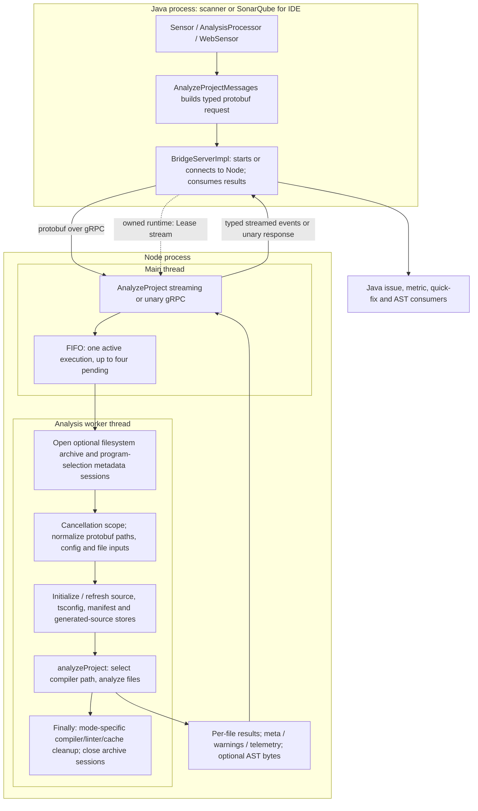
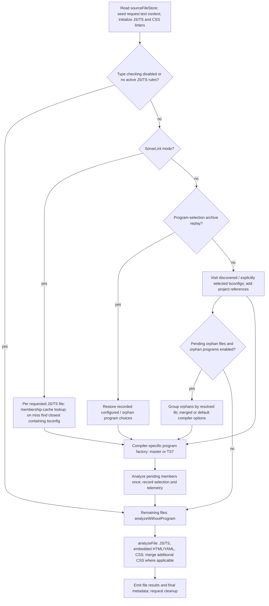
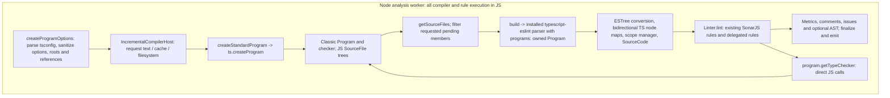
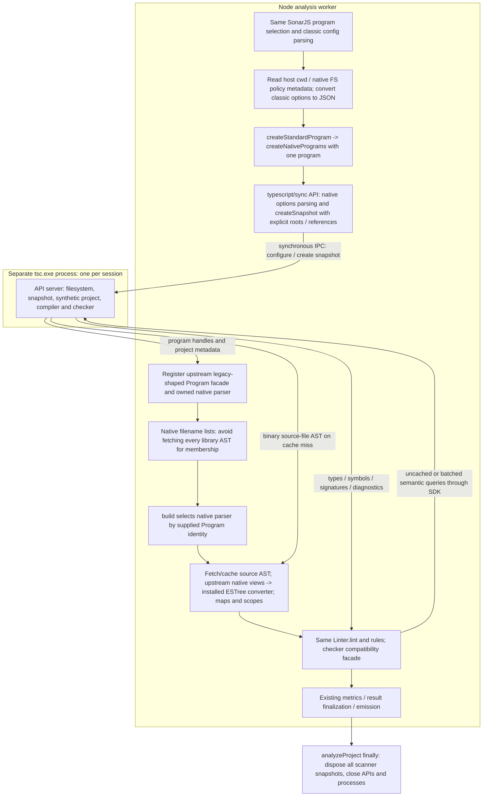
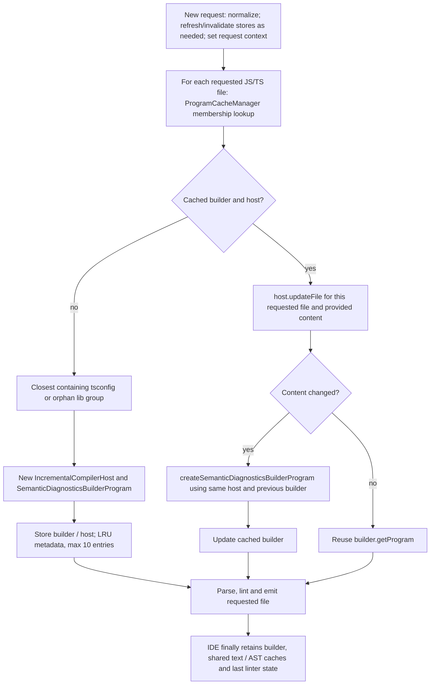
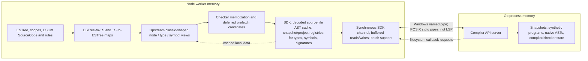
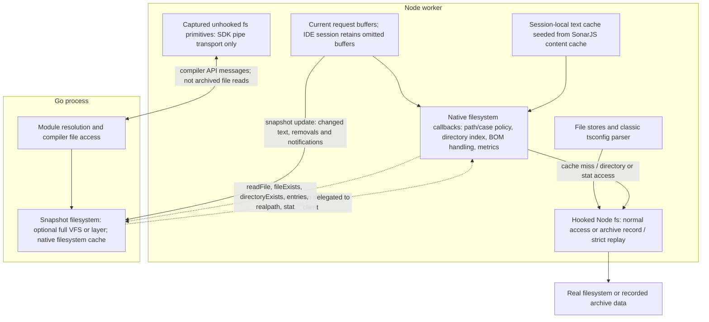
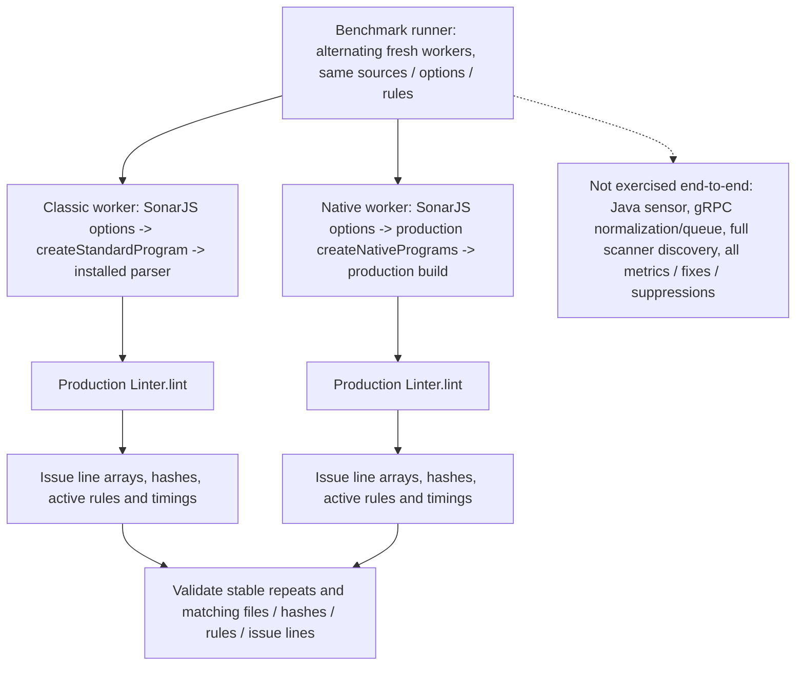
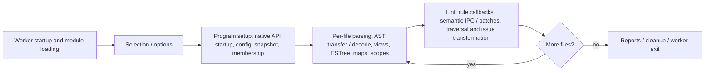

# Execution Paths: Master vs TS7

> Snapshot of the earlier native integration. The current module boundary and
> default backend are described in [single-typescript-module.md](single-typescript-module.md).

Verified against source on 2026-10-15. This describes the implementation, not a
proposed architecture. Mermaid diagrams deliberately separate processes, data
ownership, and request lifetime. Read sections 1-4 for control flow, 5-7 for IPC
and filesystem costs, and 8-10 for lifecycle and benchmark limits.

## Scope And Revisions

| Name in diagrams              | Exact state                                                                                                                                               |
| ----------------------------- | --------------------------------------------------------------------------------------------------------------------------------------------------------- |
| Master                        | `origin/master` at `9ca3d6f88f37892c497298749a8de81de62a609d`, fetched on 2026-10-15                                                                      |
| Current / TS7                 | `codex/ts7-benchmark`, base `a2b9a58b22739f0a87f7edb3f78ce03dcf248a6e`, plus the current uncommitted integration                                          |
| Master analysis compiler      | `typescript@6.0.3`, JavaScript implementation in Node                                                                                                     |
| Current analysis compiler     | `typescript@7.1.0-dev.20261015.1`, Go compiler accessed through `typescript/sync`                                                                         |
| Current classic compatibility | `typescript-classic@npm:typescript@6.0.3`; config parsing, legacy guards/types, third-party compatibility and benchmark comparator, not semantic fallback |
| ESTree integration            | Installed typescript-eslint `8.71.1`, plus vendored native adapters from PR #12803 at `30d55234e6d719d3386884c3eef5c3a6c9d255f3`                          |

The worktree has not been rebased onto the latest master. A diff between its base
and latest master showed no intervening changes in the inspected project-analysis,
program, parser-builder, gRPC source paths or `server.mjs`. Other repository changes
are not implicitly part of this prototype. The classic benchmark backend runs
this worktree's rules, not a separate checkout of master's complete analyzer.

The compiler was subsequently upgraded on the same date from the October 12
nightly to the October 15 nightly, revision
`257e87406c6a8be277cb8cd5ef8d7b458a650390`. The adapter pin and architectural
paths are unchanged. Earlier timings in section 9 still describe the explicitly
dated older-compiler run, not a measurement of the upgraded compiler.
Fresh before/after results are in the
[nightly upgrade report](C:/Users/victor.diez/projects/worktrees/SonarJS-ts7-benchmark/docs/ts7-benchmark/nightly-upgrade-20261015.md).

**Key conclusions**

- Java-to-Node gRPC is an existing boundary. Node-to-Go compiler IPC is the new boundary.
- SonarJS still owns program selection and creation. The upstream parser receives
  an owned project; it does not select projects through its own project service.
- TS7 ASTs are transferred per source file and cached in JS. AST traversal and
  ESTree-to-TS node-map lookup are not an IPC call per node.
- Semantic cache misses can cross IPC; adapter memoization, SDK object caches,
  vector endpoints and generator batching already reduce that traffic.
- Scanner native sessions live until request cleanup. Healthy IDE sessions survive
  requests, and edits update snapshots without restarting the API process.
- One process per _session_, not one process per file and not necessarily one
  process for an entire multi-tsconfig scanner project.
- Source integration is runnable; native deployment and the standalone CJS bridge
  bundle are not yet verified as a shippable product.

Solid arrows represent normal calls/data flow. Dashed arrows represent callbacks,
reuse, or optional branches. A box labeled Node worker is a thread in the Node
process, not another Node OS process. Sequence diagrams show logical calls, not
every internal SDK exchange.

## 1. Shared Entry And Result Path

Both implementations retain this path. The compiler-specific expansion of
`analyzeProject` follows in later diagrams.



The transport normalizer initializes file stores _before_ `analyzeProject`.
Explicit request files define the analyzable set; they are not necessarily all
compiler dependencies. Without filesystem access, discovery simulates a traversal
of provided files and their parent directories. It cannot discover omitted helpers.
Generated-source derivation is disabled in that request-only mode.

Cancellation is cooperative. Cancelling an active transport requests worker
cancellation but does not release the queue slot until the worker actually settles.
Neither implementation interrupts arbitrary synchronous compiler work immediately.
The new synchronous Go API can also hold the worker inside an IPC call. The main
thread can service gRPC, but the worker must resume and reach a checkpoint.

## 2. Shared Project Selection



The graph groups repeated loops: discovered configurations are processed one by
one, and each program's eligible pending files are analyzed before proceeding.
Scanner replay bypasses rediscovery of recorded choices. IDE orphan fallback
uses the matching lib group for that file, rather than taking every pending file.
Files without a program still receive the established syntax-only analysis.

## 3. Scanner: Compiler And Rule Path

### Master



There is no TS6 compiler child process for analysis. The class name
`IncrementalCompilerHost` does not turn a scanner `ts.createProgram` into an IDE
builder program. Scanner programs are ordinary classic programs.

### Current TS7



`createStandardProgram` normally allocates a session for each program factory
call. Multiple tsconfigs or orphan groups can therefore create multiple processes,
and those sessions currently remain owned until request cleanup. Scanner analysis
does not yet pool all programs into one API session. The benchmark can group
multiple programs in a single API session, so that distinction matters.

### Unchanged Parsing Side Paths

| Input                                                              | Master                                                        | Current                                                                                                      |
| ------------------------------------------------------------------ | ------------------------------------------------------------- | ------------------------------------------------------------------------------------------------------------ |
| Plain JS/TS with an owned program and TS parsing selected          | Classic typescript-eslint services                            | Owned native parser and compatibility services                                                               |
| No program, type checking disabled, or existing JS parser fallback | Existing syntax-only parser routing                           | Same routing; not a hidden classic semantic fallback                                                         |
| Vue                                                                | Established syntax-only Vue parser; supplied programs omitted | Same behavior, even when a native program is supplied                                                        |
| HTML / YAML                                                        | Existing embedded-language extraction and analysis            | Existing route; not a claim of complete native embedded-language support                                     |
| CSS and additional CSS in web/Vue files                            | Existing stylelint route                                      | Same route                                                                                                   |
| S125 comment fragments during native typed analysis                | Classic parser's independent syntax parse                     | Temporary no-lib/no-resolve native snapshot on the **same API process**, then dispose the temporary snapshot |

The S125 snapshot has its own synthetic program and full VFS for the fragment.
It neither updates the analyzed project's text nor starts a child process per comment.

## 4. IDE: First And Subsequent Requests

### Master: Builder Cache



Master retains both builder state and shared source text / parsed-SourceFile caches
across ordinary IDE requests, subject to normal invalidation. Master only calls
`Linter.releaseAfterAnalysis()` and clears those caches in `finally` for scanner
mode; IDE mode can retain the last SourceCode until later replacement. Current
TS7 deliberately releases it after both scanner and IDE requests to avoid keeping
snapshot-bound parser/checker references in ESLint. `ProgramCacheManager`
uses LRU metadata holding a key object and a WeakMap keyed by it: an active LRU
entry still strongly reaches its key, so do not interpret this as arbitrary GC of
active cached builders. Eviction removes that ownership; no child process exists.

### Current: Retained API, Updated Snapshot

```mermaid
sequenceDiagram
  participant R as New IDE request
  participant F as SonarJS factory / session cache
  participant A as JS API and FS adapter
  participant G as Persistent Go API process
  participant P as Parser / rules
  R->>F: Set new request context; prepareNativeProgramRequest(fsEvents)
  alt Existing cached sessions
    F->>A: For every cached session, apply request buffers and changed paths
    alt No text changes and no events
      Note over A,G: Keep existing snapshot and facade; no snapshot-update RPC
    else Changed buffers or disk / directory events
      A->>A: Invalidate affected FS cache; retain omitted buffers; expand known descendants
      A->>G: snapshot.update(layer, changed/created/deleted, ensurePrograms)
      G-->>A: New snapshot; same synthetic project IDs; reusable unchanged source identities
      A->>A: Register new snapshot-bound checker/parser facades
      A->>G: Dispose previous snapshot, not API
    end
  end
  loop Requested JS/TS files
    F->>F: Match baseDir, module policy and program membership; touch LRU
    alt Membership cache miss
      F->>F: Select closest config / orphan options
      F->>A: Create session, API and initial snapshot
      A->>G: Spawn new API process for this session and create program
      F->>F: Cache session; dispose oldest if more than 10
    end
    F->>P: Current owned Program facade
    P->>A: Parse / semantic requests as needed
    A->>G: Cache misses or batched queries
    P-->>R: File result
  end
  R->>F: finishNativeProgramRequest(true)
  F->>F: Assert all sessions healthy; keep healthy sessions
  Note over F,P: Release ESLint SourceCode and shared request caches, not retained session state
  Note over A,G: Next request reuses process and compiler state
```

Updates are applied once per new request context to **all cached sessions**, not
only the first session used by a requested file. This is conservative and may do
unnecessary work for unrelated programs. Omitted unsaved buffers are deltas and
remain in session state. Filesystem events can clear those retained entries; current
request buffers are reapplied with priority.

The process and synthetic project identity survive edits. Checker/type/diagnostic
facades are snapshot-bound and replaced after an update; retaining them would risk
stale semantics. Unchanged source identity reuse is tested, but total compiler
incremental cost and equivalence to classic builder diagnostic caching are not
established. Filesystem-layer ancestry and long-session memory need measurement.

The cache has ten strongly owned sessions, potentially ten processes. Configuration
and project discovery resets close the native cache, rather than reconfiguring the
existing synthetic projects in place. This is not a general cross-workspace pool.

## 5. What Is Local, What Crosses IPC?



| Operation                                                           | Typical location / behavior                                                  |
| ------------------------------------------------------------------- | ---------------------------------------------------------------------------- |
| ESLint visitor traversal                                            | Local JS over ESTree                                                         |
| `esTreeNodeToTSNodeMap.get(node)`                                   | Local JS map lookup                                                          |
| Syntax kind, parent/child traversal of an already loaded native AST | Decoded JS AST and local classic-shaped views; no per-node LSP request       |
| First `getSourceFile` for uncached source                           | Binary source-file response over IPC, decoded and retained by SDK            |
| Repeated `getSourceFile` with retained cache entry                  | SDK returns local canonical cached source                                    |
| Listing source filenames for program membership                     | Metadata/list operation, without fetching and wrapping all source-file ASTs  |
| Checker adapter call already memoized for the same arguments        | Local adapter result                                                         |
| First semantic query / missing lazy semantic property               | May require native API exchange and possibly further dependent queries       |
| Type, symbol or signature already in SDK registry                   | Reuse local object; this alone does not imply every operation on it is local |
| Syntax diagnostics in native parser adapter                         | Lazy program syntactic diagnostic fetch, grouped/cached by file in adapter   |
| Fragment parsing for S125                                           | Temporary snapshot and source transfer on existing API connection            |

`cacheGeneratorMethod` in the SDK caches the method/generator wrapper; its name
alone is **not evidence of result memoization for every API call**. Result reuse
comes from the concrete source-file/object caches and upstream checker memo tables.

There is no full serialization of the program's entire semantic graph into Node
in this implementation. Per-source AST transfer does exist. Types/symbols/signatures
are materialized as needed while native compiler state remains in Go.

## 6. Semantic Query And Batching Detail

```mermaid
sequenceDiagram
  participant E as ESLint rule
  participant M as Local node map
  participant C as Upstream checker adapter
  participant S as TS7 JS SDK
  participant G as Go compiler API
  E->>M: ESTree node to TS-shaped node
  M-->>E: Local node view
  E->>C: getTypeAtLocation(node)
  alt Adapter memo hit
    C-->>E: Cached classic-shaped type
  else Adapter memo miss
    alt Deferred prefetch threshold reached for this file
      C->>S: Vector query for unresolved candidate nodes
      S->>G: Semantic request covering multiple nodes
      G-->>S: Types / handles
      S-->>C: Native JS type objects
      C->>C: Seed memo entries for candidate nodes
    else Individual query
      C->>S: Query for this node
      S->>G: Semantic API request
      G-->>S: Type data / handle
      S-->>C: Native JS type object
    end
    C-->>E: Memoized classic-shaped type
  end
  E->>C: Signature / symbol / property query
  Note over C,G: Local cache, individual request, vector request or generator batch depending on operation
  C->>S: api.batch of independent request generators when applicable
  S->>G: batchRequests; possible additional pages / dependency rounds
  G-->>S: Batch results
  S-->>C: Seed / wrap results
```

The parser's prefetch pass first **collects candidates and registers deferred
work**; it does not eagerly query every candidate before linting. The pinned
checker adapter triggers type prefetch after at least `max(2, 10% of candidate
count)` misses. Other paths batch calls, contextual types, argument information
and parameter types when needed. Successful results seed ordinary memoization.
A speculative batch failure can fall back to individual queries; actual unsupported
or checker failures are tracked and invalidate the native session/run even when a
rule catches them.

Performance implications:

- Batching already exists. Remaining slowdown cannot be attributed simply to
  waiting for TS7 to implement batching.
- A dependent chain such as node -> type -> property -> symbol -> declaration
  cannot necessarily be one batch: the next request may need a previous answer.
- A batch can have multiple physical exchanges due to generator dependencies or
  response paging. Logical queries and physical pipe requests are different counts.
- Synchronous IPC blocks the worker thread. Separate processes do not by themselves
  mean lint execution overlaps compiler work; Go may parallelize its internal work.
- Request serialization, binary AST decoding, facade allocation, ESTree conversion
  and GC cost time outside the native checker computation itself.
- Shared per-file facts, avoiding redundant semantic walks, and smarter prefetch
  are SonarJS-side optimization candidates; none is a measured speedup here.

## 7. Filesystem, Overlays And Archives



Two different overlays are involved: the Go snapshot's optional VFS/layer, and the
Node callback adapter's request/cache overlay. Native VFS/layer resolution can
satisfy a file without a callback; delegated callback reads prefer request text,
then adapter cache, then hooked filesystem. Directory indexing supports virtual
parents. Outside-baseDir node_modules policy exempts compiler library directories.

The native callback surface replaces compiler-facing host operations:
`readFile`, `fileExists`, `directoryExists`, `getAccessibleEntries`, `realpath`,
and `stat`. Compiler writes/removals are no-ops in this analysis integration.
Classic `ParseConfigHost` behavior remains on the config-discovery side.

`createNativePrograms` also accepts custom callback overrides and a `typescript/fs`
filesystem. Normal calls use SonarJS defaults. The old `CompilerHost` object is
not forwarded wholesale: only explicit cwd / policy metadata is consumed.
Arbitrary `getSourceFile`, module resolution, builder-host or other classic Host
overrides require explicit migration; no generic Host-to-native translation exists.

Provided request text is captured by archive hooks even when unchanged. Native
callback reads retain existing filesystem recording/replay behavior. Raw API pipe
I/O must bypass those hooks so replay does not mistake transport handles for project
files. Compiler library passthrough means an archive is not a hermetic compiler
installation. Custom callback overrides own their recording and accounting behavior.

## 8. Cache Ownership And Teardown

| State                                                  | Master                                                                                          | Current TS7                                                                                                    | Request boundary                                                                                                             |
| ------------------------------------------------------ | ----------------------------------------------------------------------------------------------- | -------------------------------------------------------------------------------------------------------------- | ---------------------------------------------------------------------------------------------------------------------------- |
| Source / tsconfig / manifest / generated-source stores | Node                                                                                            | Node, unchanged architecture                                                                                   | Scanner resets; IDE refreshes or retains according to store-specific config/events                                           |
| Raw tsconfig and parsed program options                | Node caches                                                                                     | Same classic-side caches                                                                                       | Cleared by tsconfig/project reset                                                                                            |
| Shared source text and parsed classic SourceFiles      | Node global cache; retained across IDE requests, cleared at scanner end and normal invalidation | Still present for classic-side paths; not native program ownership; cleared at request start/end in both modes | Current IDE session has separate retained state                                                                              |
| IDE compiler program                                   | Builder + host in membership-keyed LRU/WeakMap                                                  | Strong session LRU; API, snapshot, membership and FS adapter                                                   | Retain healthy entries; max 10                                                                                               |
| Native decoded source AST                              | Not applicable                                                                                  | SDK API-level cache with snapshot/project retention                                                            | May survive snapshot update for unchanged source; released according to retention/disposal                                   |
| Upstream node views                                    | Classic AST already local                                                                       | Native-node-backed views and local child/array caches                                                          | Unchanged native node views can survive; temporary traversal children released after conversion                              |
| Checker/type facade caches                             | Classic compiler and parser state                                                               | Upstream memo tables, views and SDK semantic object registries                                                 | Snapshot-bound semantic adapters replaced after update                                                                       |
| ESTree, node maps, ESLint SourceCode                   | Per parsing / linting; last SourceCode can survive IDE request                                  | Same JS artifacts, native maps produced upstream                                                               | Master explicit release only at scanner end; current release after every project request; GC depends on remaining references |
| Native compiler state                                  | Not applicable                                                                                  | Go process and snapshot-owned programs/checker state                                                           | Scanner dispose; IDE retain/update until explicit teardown                                                                   |

| Event                                                 | Master                                                                                    | Current TS7                                                                                                                                              |
| ----------------------------------------------------- | ----------------------------------------------------------------------------------------- | -------------------------------------------------------------------------------------------------------------------------------------------------------- |
| Successful scanner request                            | Release request/linter caches; JS programs become collectible                             | Also dispose scanner snapshots and close API child processes                                                                                             |
| Successful IDE request                                | Keep builder cache and last linter/cache state                                            | Keep healthy sessions, snapshots and child processes; release ESLint and shared request caches                                                           |
| Unchanged IDE request                                 | Builder reuse follows current host/content checks                                         | Same native snapshot/facade if no text or filesystem changes; linting requested files still runs                                                         |
| Changed IDE source/dependency                         | Classic host/builder update path                                                          | Targeted layer + notifications; same API/process/project, fresh snapshot-bound facades                                                                   |
| LRU eviction                                          | Drop builder ownership                                                                    | Explicitly dispose snapshot and close API/process                                                                                                        |
| Tsconfig/project discovery reset                      | Clear config/options/program caches                                                       | Same plus native cache/process disposal                                                                                                                  |
| Native callback/checker/unsupported-operation failure | Not applicable                                                                            | Health tracking fails request/run and clears failed native ownership; no classic semantic fallback                                                       |
| Cooperative cancellation                              | Existing mode-specific finally cleanup; IDE does not explicitly release last ESLint state | Always release ESLint/shared request caches; scanner closes sessions, IDE can keep healthy sessions; cancellation alone does not force a process restart |
| Graceful owned runtime shutdown                       | Java Lease closes Node runtime                                                            | Node shutdown plus SDK exit cleanup for live native children                                                                                             |
| Worker crash / forced termination / stuck native call | Existing queue/runtime failure handling                                                   | No new supervised recovery guarantee; abrupt termination and orphan-process behavior need dedicated tests                                                |

A generic request failure is not automatically a compiler corruption signal.
Native failures recorded by adapters trigger disposal; a healthy IDE session may
survive other failures. Initialization/update failures have explicit cleanup.

## 9. Benchmark Path vs Product Path



The integrated benchmark uses the production compiler session, builder selection
and rules. It intentionally calls a narrower path than `analyzeProject`: it loops
over configured source roots and measures parse/lint separately. Native worker
creation can group selected programs in one session. Classic worker parsing calls
the installed parser directly with the owned classic program. These are not
identical whole-product execution paths, and the harness is not a replacement for
scanner ruling or IDE incremental workload tests.

Latest integrated ag-grid run, 2026-10-15, three fresh workers per backend:

| Median           |  Classic |   Native |
| ---------------- | -------: | -------: |
| Program setup    |  0.672 s |  0.376 s |
| Parsing          |  0.977 s |  1.966 s |
| Linting          | 12.784 s | 18.755 s |
| Analysis total   | 14.569 s | 21.189 s |
| Worker wall time | 25.962 s | 30.904 s |

157 files and 6,524 issue lines matched in every run; matching input hashes,
active rules and repeat stability were checked. Native/classic total-analysis
ratio was 1.454, approximately 45% slower in this sample. Phase medians need not
sum to median total. These measurements do not isolate IPC and do not measure
the subsequent IDE incremental-lifecycle change. Historical method/rule/CPU
profiles in the ag-grid note describe the earlier layout, not fresh attribution
of these integrated timings.

### Timing Boundaries



Native prefetch candidates are registered while parsing, but deferred requests can
be triggered while linting. Therefore a higher lint time can include compiler work,
not just JS rule CPU. In profiled runs, rule callback timings are inclusive of
their IPC, so adding rule time and IPC time double-counts. SDK round-trip time is
not a complete measurement of all serialization, decoding, conversion or GC cost.

## 10. Evidence And Remaining Gaps

Source-audited in this document: normal factories, cleanup, parser registration,
native snapshots, SDK source cache, batching/memoization, callbacks, queue and
request normalization. Existing docs supplied the broader scanner/IDE context;
older SonarLint Core scheduling details were not independently re-fetched here.

Previously executed validation recorded in this worktree:

- `npm run bbf` and final test compilation passed.
- 43 focused TS7 tests passed, plus 8 tsconfig-cache tests. The lifecycle subset
  overlaps those tests; it is not an extra independent total.
- Tests cover successive real SonarLint project requests, retained API/project,
  changed types, omitted buffers, unchanged native source identity, dependency
  deletion/recreation, directory events, LRU/reset and native-failure cleanup.
- Integrated ag-grid parity and timings are the bounded evidence above.

This documentation change does not rerun those builds or benchmarks. No new
incremental IDE timing result is claimed.

Still unverified or incomplete:

- Full rule suite, full scanner ruling and packaged native deployment/CJS bridge.
- Complete message, secondary-location, quick-fix and suppression parity.
- Long-running IDE memory, layer ancestry, update cost and multi-session fan-out.
- Full cancellation/crash recovery and native child cleanup under abrupt termination.
- Arbitrary legacy Host customization and native embedded-language typed mappings.
- Whether optimizations should target IPC dependencies, JS adapters, repeated rule
  semantic work, process/session pooling, or several of these: measure on the
  integrated path before choosing.

## Source Map

Master links are pinned to the fetched revision. Current links refer to this
worktree, including uncommitted changes, and will change if the worktree is edited.

| Topic                      | Master                                                                                                                                                                          | Current                                                                                                                                                  |
| -------------------------- | ------------------------------------------------------------------------------------------------------------------------------------------------------------------------------- | -------------------------------------------------------------------------------------------------------------------------------------------------------- |
| Project orchestration      | [analyzeProject.ts](https://github.com/SonarSource/SonarJS/blob/9ca3d6f88f37892c497298749a8de81de62a609d/packages/analysis/src/analyzeProject.ts)                               | [analyzeProject.ts](C:/Users/victor.diez/projects/worktrees/SonarJS-ts7-benchmark/packages/analysis/src/analyzeProject.ts)                               |
| Scanner selection          | [analyzeWithProgram.ts](https://github.com/SonarSource/SonarJS/blob/9ca3d6f88f37892c497298749a8de81de62a609d/packages/analysis/src/analyzeWithProgram.ts)                       | [analyzeWithProgram.ts](C:/Users/victor.diez/projects/worktrees/SonarJS-ts7-benchmark/packages/analysis/src/analyzeWithProgram.ts)                       |
| IDE selection              | [analyzeWithIncrementalProgram.ts](https://github.com/SonarSource/SonarJS/blob/9ca3d6f88f37892c497298749a8de81de62a609d/packages/analysis/src/analyzeWithIncrementalProgram.ts) | [analyzeWithIncrementalProgram.ts](C:/Users/victor.diez/projects/worktrees/SonarJS-ts7-benchmark/packages/analysis/src/analyzeWithIncrementalProgram.ts) |
| Factories and IDE lifetime | [factory.ts](https://github.com/SonarSource/SonarJS/blob/9ca3d6f88f37892c497298749a8de81de62a609d/packages/analysis/src/jsts/program/factory.ts)                                | [factory.ts](C:/Users/victor.diez/projects/worktrees/SonarJS-ts7-benchmark/packages/analysis/src/jsts/program/factory.ts)                                |
| Classic host               | [compilerHost.ts](https://github.com/SonarSource/SonarJS/blob/9ca3d6f88f37892c497298749a8de81de62a609d/packages/analysis/src/jsts/program/compilerHost.ts)                      | [compilerHost.ts](C:/Users/victor.diez/projects/worktrees/SonarJS-ts7-benchmark/packages/analysis/src/jsts/program/compilerHost.ts)                      |
| Parser routing             | [build.ts](https://github.com/SonarSource/SonarJS/blob/9ca3d6f88f37892c497298749a8de81de62a609d/packages/analysis/src/jsts/builders/build.ts)                                   | [build.ts](C:/Users/victor.diez/projects/worktrees/SonarJS-ts7-benchmark/packages/analysis/src/jsts/builders/build.ts)                                   |

Additional current implementation references:

- [Native session, snapshot update and disposal](C:/Users/victor.diez/projects/worktrees/SonarJS-ts7-benchmark/packages/analysis/src/jsts/native/session.mjs)
- [Owned parser and S125 temporary snapshots](C:/Users/victor.diez/projects/worktrees/SonarJS-ts7-benchmark/packages/typescript/compat/program.mjs)
- [Native filesystem callbacks](C:/Users/victor.diez/projects/worktrees/SonarJS-ts7-benchmark/packages/analysis/src/jsts/native/filesystem.mjs)
- [Compatibility bootstrap](C:/Users/victor.diez/projects/worktrees/SonarJS-ts7-benchmark/packages/analysis/src/jsts/native/compatibility.mjs)
- [Upstream conversion and deferred prefetch](C:/Users/victor.diez/projects/worktrees/SonarJS-ts7-benchmark/packages/typescript/compat/program.mjs)
- [Checker memoization and batching](C:/Users/victor.diez/projects/worktrees/SonarJS-ts7-benchmark/packages/typescript/compat/nativeCheckerAdapter.ts)
- [SDK snapshots, source cache and semantic registries](C:/Users/victor.diez/projects/worktrees/SonarJS-ts7-benchmark/node_modules/typescript/dist/api/sync/api.js)
- [SDK synchronous transport and process ownership](C:/Users/victor.diez/projects/worktrees/SonarJS-ts7-benchmark/node_modules/typescript/dist/api/syncChannel.js)
- [Request normalization](C:/Users/victor.diez/projects/worktrees/SonarJS-ts7-benchmark/packages/grpc/src/analyze-project-normalize.ts)
- [Request/archive lifetime](C:/Users/victor.diez/projects/worktrees/SonarJS-ts7-benchmark/packages/grpc/src/analyze-project-handle-request.ts)
- [Single-flight queue](C:/Users/victor.diez/projects/worktrees/SonarJS-ts7-benchmark/packages/grpc/src/analyze-project-server-queue.ts)
- [Per-file language dispatch and finalization](C:/Users/victor.diez/projects/worktrees/SonarJS-ts7-benchmark/packages/analysis/src/analyzeFile.ts)
- [JS/TS parser, linter and metrics path](C:/Users/victor.diez/projects/worktrees/SonarJS-ts7-benchmark/packages/analysis/src/jsts/analysis/analyzer.ts)
- [Tsconfig-triggered native cache invalidation](C:/Users/victor.diez/projects/worktrees/SonarJS-ts7-benchmark/packages/analysis/src/file-stores/tsconfigs.ts)
- [Benchmark worker and timing boundaries](C:/Users/victor.diez/projects/worktrees/SonarJS-ts7-benchmark/tools/ts7-benchmark/worker.mjs)

Existing explanatory documentation:

- [Master cache architecture](C:/Users/victor.diez/projects/worktrees/SonarJS-ts7-benchmark/docs/node-analysis-caches.md)
- [File-store discovery and refresh](C:/Users/victor.diez/projects/worktrees/SonarJS-ts7-benchmark/docs/file-stores.md)
- [Typed gRPC, worker and Lease architecture](C:/Users/victor.diez/projects/worktrees/SonarJS-ts7-benchmark/docs/grpc-analyze-project-migration.md)
- [IDE scheduling and cancellation](C:/Users/victor.diez/projects/worktrees/SonarJS-ts7-benchmark/docs/sonarlint-analyze-project-concurrency.md)
- [Native integration and validation record](C:/Users/victor.diez/projects/worktrees/SonarJS-ts7-benchmark/packages/analysis/src/jsts/native/README.md)
- [Ag-grid results and historical profiling](C:/Users/victor.diez/projects/worktrees/SonarJS-ts7-benchmark/docs/ts7-benchmark/ag-grid.md)
- [Benchmark plan](C:/Users/victor.diez/projects/worktrees/SonarJS-ts7-benchmark/docs/ts7-benchmark/plan.md)
