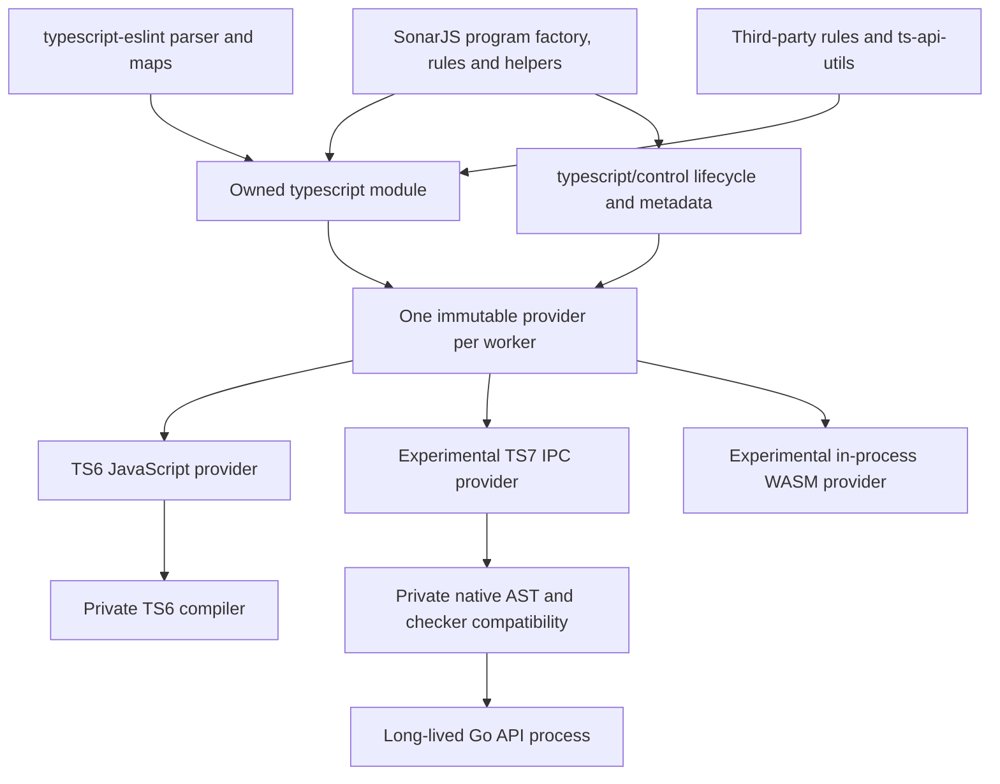

# One TypeScript Module For Every Consumer

Date: 2026-10-15.

This supersedes the earlier split between an SDK-free SonarJS service and a
TypeScript-compatible dependency gateway. There is one active compiler contract:
the SonarJS-owned `typescript` package. SonarJS and third-party code use that
same module, not two interfaces with different object models.

## Architecture



The public API is deliberately TypeScript-compatible: existing `Program`,
`TypeChecker`, `CompilerHost`, syntax utilities and enums keep their familiar
shape. Its declarations currently reuse the TS6 declaration schema. That is a
build-time compatibility choice, not permission for consumers to load TS6 at
runtime, nor proof that TS7 implements every declared member.

`typescript/control` supplies backend-neutral initialization, retained-project
lifecycle, cache policy, filename metadata, audit controls and optional diagnostic
instrumentation. Program metrics expose copied counters/timings, not SDK APIs,
raw programs or native sessions. It is part of the same package;
it is not a second semantic interface for SonarJS rules.

## Resolution And Ownership

- Root dependency `typescript` is `file:packages/typescript`.
- Application and dependency CJS/ESM imports resolve to the same guarded facade.
  Import interception applies to all importers, not just `node_modules`.
- Supported historical `lib/typescript` and `lib/tsserverlibrary` entry points
  resolve to that facade too. Unsupported compiler subpaths fail explicitly.
- Physical compiler imports, nested compiler copies and npm aliases are checked
  by package identity, including compiler checkouts outside `node_modules`.
  Only explicit private implementation roots bypass routing. Runtime and bundle
  resolution share `packages/typescript/boundary.cjs` for compiler identities,
  supported entries and implementation roots; similarly named directories in a
  consumer's own tree do not gain implementation privileges.
- `typescript-classic` and `typescript-native` are private compiler dependencies.
  Production consumers outside those roots are audited for direct imports.
- One provider is fixed for the worker lifetime. Select before importing consumers;
  live compiler objects cannot be switched to another backend halfway through.
- `server.mjs` loads the module and initializes its backend before importing the
  analysis server/worker. Already-retained ESM bindings cannot be repaired later.
- Bundling uses `tools/typescript-module-plugin.mjs` to enforce the boundary before
  esbuild inlines imports. Runtime hooks alone cannot enforce an inlined graph.

The earlier SDK-free service experiment has been removed. The production factory,
parser builder, project analysis and rules all use the same TypeScript-compatible
module; no second declaration model or adapter service is shipped.

## Providers

Default `SONARJS_TYPESCRIPT_BACKEND=ts6` uses the private TS6 compiler through
our module. Standard and incremental program creation follow the existing
SonarJS factory/host path, and typescript-eslint receives the same program and
node maps as the analyzer. Program creation is not artificially forbidden to
dependencies: they see the same compiler contract as SonarJS.

`SONARJS_TYPESCRIPT_BACKEND=ts7` selects the experimental native provider.
Source execution additionally sets `SONARJS_TYPESCRIPT_SOURCE=1` and uses TSX;
compiled execution uses the private integration under `lib/analysis/src/jsts`.
Call `initializeCompiler()` before program/session operations. The provider owns
the compiler compatibility translation and retained project cache. SonarJS selects the project,
options, roots and host through its normal code; native-specific adaptation stays
behind the module controls.

### Released Parser, Not A PR Parser

Both providers use unchanged `@typescript-eslint/parser` **8.71.1**, matching
master `54ed0347accda1232bb85b625b5167f3817bd729`. There is no provider parser
selection, patched parser-services pipeline, PR download or native parser bundle.
SonarJS supplies its program with `parserOptions.programs` just as on master.
The released parser owns ESTree conversion, both node maps, scopes and visitor keys.

`packages/typescript/compat` owns native Program/Node/Type/Checker translation.
Its adapter algorithms were derived from the MIT-licensed native experiment;
the LICENSE and NOTICE record that provenance. We maintain that compiler code,
not a forked typescript-eslint parser. No translation code imports parser internals.
The module generator bundles these sources into ignored `native-compat.mjs`.

Checker memoization and lazy batch candidate scheduling remain behind the compiler
contract. Compatibility views and semantic caches are snapshot-scoped. Merely
traversing a file does not eagerly request every node's type. Syntax-only parsing
(including S125 comment fragments) uses the released parser and the module's local
TS6 syntax utilities; it does not create a second semantic program.

The native provider currently reuses TS6 local syntax/configuration utilities,
but creates semantic programs through Go. It reports a TS6 compatibility shape
to the existing parser; `getCompilerInfo()` separately reports the native version.
Unsupported compiler/builder/language-service constructors are rejected rather
than silently creating a classic semantic program. Unknown facade members and
gateway failures remain fatal even if a dependency catches the immediate error.
This remains a partial compatibility implementation, not a complete TS6 SDK clone.

`SONARJS_TYPESCRIPT_BACKEND=wasm` selects an experimental in-process build of the
Go API handlers. It reuses the native compatibility views and released parser,
but replaces the SDK's pipe channel with direct synchronous JS/WASM calls.
See the [WASM experiment](wasm.md) for build instructions, tested coverage,
measurements and limitations. This is not zero-copy or an official Go/WASM API.

## Filesystems And Lifetimes

The TS6 default preserves the original compiler host and system behavior.
Filesystem customization uses the standard TypeScript host callbacks and existing
SonarJS filesystem hooks. There is no separate scoped-filesystem control API.

Native program creation adapts provided host callbacks to the native virtual FS.
The public compiler host advertises the selected backend's standard-library
directory, allowing restricted hosts to admit the correct declarations.
Existing filesystem archive record/replay and retained IDE snapshot tests exercise
the integration. Omitting an optional directory probe means unknown, as in TS6;
it is not permission to consult a different filesystem. Arbitrary custom host
and language-service semantics are not comprehensively validated yet.

Filename enumeration uses provider metadata so native analysis need not hydrate
every library AST over IPC just to select the requested files.

TS6 IDE requests preserve master's source-cache and incremental-builder lifetime.
Compiler-backed parser state is cleared at request boundaries because it is snapshot-bound.
Scanner requests release their native sessions at the analysis boundary. IDE
requests retain the process and project snapshots, applying file changes rather
than spawning a process per file or rebuilding on every request.

## Verification

```sh
npm run typescript:generate
npm run bridge:compile
npm run bridge:bundle
npm run ts7:test
```

The generator produces the plain-Node CJS gateway, ESM named exports and native
compiler compatibility bundle; compiled
and bundled builds invoke it automatically. Do not edit generated outputs.

Current checks cover CJS/ESM identity, application/dependency routing, a non-TS6
provider, bypass rejection, static production imports, bundled parser/checker
execution, native incremental requests and filesystem record/replay. This is not
full repository/scanner/fix parity.

Post-cleanup validation passed 322 source tests (64 module/native/FS tests plus
258 existing TS6 program/builder/project tests) and 30 compiled module/native
tests. The obsolete service/SDK-free-contract tests were removed along with that
implementation; the active gateway tests now import the shared module directly.
Standard compiler-host callbacks are explicitly tested with both backends.
Source/build evidence is in `tools/ts7-benchmark/out/cleanup-validation.log` and
`cleanup-build.log`; compiled tests without global transport preloading are in
`cleanup-provider-bootstrap.log`. The earlier `released-parser-*` and `unified-*`
logs record preceding implementation stages, not the final cleaned-up diff.

The released-parser ag-grid check passed with 157 files, 1,085 rule/language
configurations and 6,524 identical rule/file/line findings. File lists, source
texts and active rules also match; no unsupported members or checker failures
were reported. This was rerun after cleanup; see
`tools/ts7-benchmark/out/cleanup-ag-grid/summary.json`. The single profiled pair
measured 22.98s TS6 versus 29.58s TS7 analysis time (1.29x).
These are feasibility measurements with instrumentation, not performance parity
or a controlled comparison with the former PR parser. Source/compiled native
tests separately check retained IDE requests and use of the released parser.

The standalone TS6 bridge is bundled and startup-tested. Standalone TS7 packaging
is not implemented; selecting it in that bundle fails explicitly. The native
source/compiled benchmark remains available outside the standalone bundle.

The master comparison harness now uses the real production factory/build/linter
on both sides. Each candidate report includes `compilerRouting` with provider,
facade identity, SonarJS importers and typescript-eslint importers. Earlier measurements of the retired service must not be presented as measurements
of this module design.

The cross-provider benchmark now preloads the owned module before resolving the
worker's static consumer graph and requires that same routing evidence for TS6,
IPC and both WASM bridges. Caught gateway failures remain fatal at validation and
cleanup. Static production-import auditing also resolves compiler package
identities and rejects imports into private native/compatibility implementations.
Both benchmark providers now create programs through the production factory and
host, with selection behind the owned `ts.createProgram`. The earlier worker's
private native-construction path has been removed. See the
[interface/allocation comparison](interface-20261016.md) for the corrected
four-provider results and isolated gateway allocation experiment.

The [new five-pair ag-grid comparison](unified-ts6-master-ag-grid.md) records
matching issue lines and shared-module routing, plus measured timing/memory ranges.
