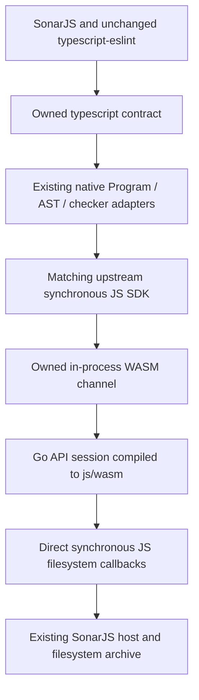

# In-Process WASM Experiment

Date: 2026-10-15. Experimental implementation for JS-2643; not an upstream-supported
WASM distribution or public Go API.

## Architecture



Select `SONARJS_TYPESCRIPT_BACKEND=wasm` before loading consumers. The compiler
contract, released parser, node mapping and native project cache are unchanged.
There is no native compiler child process, pipe, LSP or MessagePack framing.
Multiple sessions share one Go runtime per Node worker; retained IDE snapshots
continue to work, and closing a session releases its project state.

The bridge calls `api.Session.HandleRequest` directly. A Go build overlay adds
one session constructor in the internal API package so it can reuse upstream's
filesystem callback implementation without modifying the upstream checkout.
The JS SDK and WASM source revisions must match; the build helper checks this.
This is our bridge to unstable internal Go code, not a new official API.

Requests still serialize JSON. Results retain the SDK's JSON/binary formats.
`SONARJS_WASM_BRIDGE=direct` enables direct WASM exports and linear-memory byte
views (see below); `syscall` selects the original `syscall/js` transport and
remains the default because total analysis time did not improve in the trial.
This does **not** share Go AST objects with JavaScript and is
not an end-to-end zero-copy API.
Go's `js/wasm` runtime is single-threaded here, unlike the native compiler.
Local syntax/configuration utilities still use private TS6, just as the IPC provider does.

### Direct-Export Bridge

This optimization only changes our Go/Node bridge. It does not require changing
the upstream compiler, the owned TypeScript contract, rules or typescript-eslint.
The build helper includes `direct.go` alongside the existing Go entry point.

1. `sonarReserve(size)` allocates a Go-rooted input buffer and returns its address.
   Node caches its address/capacity, reserving again only for larger requests.
2. Node writes the method and payload into WASM memory. JSON strings are UTF-8
   encoded directly into that buffer, without an intermediate Node byte buffer.
3. `sonarRequest(session, methodLength, payloadLength)` invokes the same
   `HandleRequest` and serialization implementation used by the old bridge.
4. Its return value points at three little-endian uint32 fields: response
   address, byte length and error flag. Go roots both descriptor and response
   bytes until the next request. JSON strings are decoded directly from memory;
   binary responses are copied into Node-owned Buffers because the SDK's lazy
   AST decoding can retain them across subsequent requests.

Normal requests therefore make one direct export call rather than entering a
`js.FuncOf` wrapper and creating/copying a JS Uint8Array response. An input growth
adds one reserve call. This is still a byte-oriented ABI, not a typed checker
API; JSON marshal/unmarshal and Go response allocations remain.

Node reconstructs its memory views after calls, because WASM memory growth can
detach old views. All sessions in a worker share the buffer and are synchronous.
Nested compiler requests, session creation and session closure from filesystem
callbacks are explicitly rejected. Session open/close and filesystem callbacks
still use `syscall/js`; those less frequent paths were not rewritten.

The ABI assumes wasm32 and the pinned Go runtime. It is our experimental internal
ABI, not an upstream compatibility guarantee. An older artifact without these
exports fails with a rebuild instruction unless the syscall bridge is selected.

## Build And Run

Requires Node 24, Go 1.27, a clean TypeScript Go checkout, and an immutable matching
JS SDK snapshot. The earlier source-build helper can produce that snapshot after
building the upstream compiler and JS API; see [source-build instructions](pr64823-source-build.md).

The current local checkout/snapshot use source revision
`257e87406c6a8be277cb8cd5ef8d7b458a650390` and Go 1.27.2:

```powershell
$env:SONARJS_GO='C:\Users\victor.diez\sdk\go1.27.2\go\bin\go.exe'
node tools/ts7-benchmark/build-wasm.mjs C:\Users\victor.diez\projects\TypeScript tools/ts7-benchmark/out/pr64823-20261015/base-sdk
$env:SONARJS_TS7_WASM=(Resolve-Path tools/ts7-benchmark/out/wasm).Path
$env:SONARJS_WASM_BRIDGE='direct' # opt-in experiment; omit for original bridge
node tools/ts7-benchmark/benchmark.mjs --native-backend wasm --rules all --runs 1 --profile
```

For a same-binary transport comparison, set `SONARJS_WASM_BRIDGE=syscall` or
`direct` in a fresh worker before running the same benchmark. The native result
records `wasmBridge`. Alternate order and repeat runs without other builds/tests
running; collect CPU profiles separately. The default is `syscall`.

Builds, copied runtime/SDK files and results stay under ignored `out/`; the WASM
binary is approximately 39.8 MB and is not committed. The existing native source
snapshot contains a native executable, but the WASM provider does not spawn it.

For the same compiler revision over IPC:

```powershell
node tools/ts7-benchmark/benchmark.mjs --native-sdk tools/ts7-benchmark/out/pr64823-20261015/base-sdk --rules all --runs 1 --profile
```

Run the production integration tests against WASM:

```powershell
$env:SONARJS_NATIVE_TEST_BACKEND='wasm'
$env:SONARJS_WASM_BRIDGE='direct'
$env:TSX_TSCONFIG_PATH='packages/tsconfig.test.json'
node --import tsx --import ./tools/ts7-benchmark/test-backend.mjs --test packages/analysis/tests/ts7/native.test.ts tools/ts7-benchmark/wasm.test.mjs
node --test tools/ts7-benchmark/benchmark.test.mjs
Remove-Item Env:SONARJS_NATIVE_TEST_BACKEND
```

## Validation And Measurements

- Fixture: 2 files, 11 identical rule/file/line findings with all rules.
- Ag-grid: 157 files, 6,524 identical findings, matching source hashes/file lists/active rules.
- All 11 production native integration tests pass with WASM selected, including
  released-parser node maps, IDE snapshots/dependency edits, filesystem notifications,
  custom compiler-host callbacks, cache eviction and explicit unsupported-operation failures.
- Channel tests cover arbitrary binary bytes, independent sessions, timing/reset,
  request errors, idempotent closure, retained binary responses after actual WASM
  memory growth, empty/Unicode payloads, malformed JSON, and rejected recursive
  requests/session lifecycle operations from filesystem callbacks. The same
  tests pass with either bridge. No native child process is present.
- The benchmark archive record/replay integration test passes with WASM, including
  optional profiling, S125 fragments, type-dependent and deprecation findings.
- Source compilation passes. This is not exhaustive scanner/framework/API validation.
- The 30 default TS6/native module integration tests and bridge bundling also pass.

Single profiled ag-grid runs, **not** a controlled performance study:

| Metric                                | Native IPC | In-Process WASM |
| ------------------------------------- | ---------: | --------------: |
| Analysis                              |    20.58 s |         32.37 s |
| Program creation                      |     0.30 s |          1.04 s |
| Parse                                 |     1.88 s |          2.61 s |
| Lint                                  |    18.28 s |         28.58 s |
| API requests                          |     23,728 |          23,728 |
| API round-trip total                  |     3.78 s |         11.24 s |
| Go handler time                       |     1.46 s |          6.93 s |
| Remaining boundary/serialization time |     2.32 s |          4.31 s |

Both use the exact source revision above. The original WASM run took 31.96 s;
the rerun with Go handler timing enabled took 32.37 s. TS6 in the surrounding
pairs ranged from 14.28 to 20.74 s, illustrating environmental variation;
some validation jobs overlapped. Do not treat these as speedup/regression ratios
or compare them directly with older nightly runs.

The new `compilerInitializationMs` reports backend initialization separately;
the timed WASM rerun measured 0.42 s. Analysis time does not include that startup
or all worker/module-loading overhead. RSS for WASM includes the Go heap inside
Node; a zero child-process RSS is **not** zero compiler memory.

WASM timing uses the same SDK result schema, whose legacy field names still say
`ipc`/`transportOverheadMs`. The report explicitly identifies `in-process-wasm`;
the remainder includes serialization/copying/JS-WASM crossings, not IPC latency.
Go background timers are unreferenced in the pinned runtime shim so they do not
own Node's process lifetime. They are not cancelled; an active server still runs them.

Evidence under `tools/ts7-benchmark/out/`: `wasm-ag-grid-final/`,
`wasm-matched-ipc/`, `wasm-native-tests.log`, `wasm-channel-archive-tests.log`,
`wasm-final-tests.log`, and `wasm-compile.log`.

### Direct-Export Experiment (2026-10-15)

Three runs per bridge, in syscall/direct, direct/syscall, syscall/direct order.
Both paths use the same newly built binary, Go version and SDK revision above.
All six runs analyzed 157 files, made 23,728 requests and matched 6,524 findings
at the same rule/file/lines, with no unsupported operations or checker failures.
These are normal timed runs with SDK timing enabled, not CPU profiles.

| Trial  | Syscall Analysis | Direct Analysis | Syscall Boundary | Direct Boundary |
| ------ | ---------------: | --------------: | ---------------: | --------------: |
| 1      |          30.70 s |         34.71 s |           4.31 s |          2.18 s |
| 2      |          25.23 s |         34.98 s |           3.56 s |          2.29 s |
| 3      |          26.53 s |         29.46 s |           3.70 s |          2.03 s |
| Median |          26.53 s |         34.71 s |           3.70 s |          2.18 s |

The measured boundary remainder fell about 41% by median. However, median API
round-trip time was 10.06 s versus 10.76 s, with Go handler time rising from
6.36 s to 8.58 s; total analysis was slower in every direct run. Individual
column medians need not add up to the median total. These timing scopes do not
isolate a pure crossing cost: the remainder includes serialization and callbacks.

Desktop timing variability is material: the adjacent TS6 references ranged from
13.88 s to 18.39 s. In trial 3 their times were nearly identical (14.49 s versus
14.43 s), yet direct WASM was still slower. Do not dismiss the overall result as
noise or claim an end-to-end speedup. Higher handler and non-API costs need
profiling before promoting this bridge. It remains opt-in; no upstream compiler
changes or consumer changes were needed, and the old transport remains available.

Evidence: `out/wasm-bridge-{syscall,direct}-{1,2,3}/` and
`out/wasm-bridge-comparison.json`. The latter records every timing, compiler
revision, Go version and binary SHA-256. Tests/builds were not run alongside
the six WASM analyses; the first TS6 reference overlapped the tail of the
archive validation. Startup/module loading is reported separately from analysis.

Final validation passed: 14 production/channel tests with the direct bridge,
3 channel tests with the syscall bridge, 30 default TS6/native regression tests,
and 6 benchmark archive/CLI tests with the direct bridge. Source compilation and
bundling passed, retaining the two existing guarded `require.resolve` warnings.
Logs: `out/wasm-direct-final-tests.log`, `out/wasm-direct-default-regressions.log`,
`out/wasm-direct-final-archive.log`, `out/wasm-direct-compile.log` and
`out/wasm-direct-bundle.log`.

## Next Performance Work

The next step is measurement and regression isolation, not another wholesale
bridge rewrite. In the last pair, TS6 analysis was 14.43 s and direct WASM was
29.46 s, of which only 2.03 s was the measured boundary remainder. Even removing
that remainder completely would leave roughly 27.43 s under the same timing
assumptions. This is an upper-bound thought experiment, not a speedup forecast;
the timing scopes exclude some JSON/adapter work and interact with allocation/GC.

Recommended order (all proposals, not implemented or guaranteed improvements):

| Priority | Experiment                                       | Scope And Acceptance                                                                                                                                                                                                                                                                                                                                                                                    |
| -------: | ------------------------------------------------ | ------------------------------------------------------------------------------------------------------------------------------------------------------------------------------------------------------------------------------------------------------------------------------------------------------------------------------------------------------------------------------------------------------- |
|        1 | Isolate the direct-path regression               | Add sampled bridge stage/byte counters, Node CPU/GC attribution, Go allocation/GC counters and handler subphase timers. Compare syscall/direct with identical settings and retained/cold sessions separately. Test string decoding, binary buffer ownership/allocation and exported-call scheduling independently. Recover total-runtime parity with the syscall path before making direct the default. |
|        2 | Reduce expensive work in the compatibility layer | Use method/rule profiles to find repeated logical queries, adapter materialization and ineffective prefetch. Memoization and batching already exist; add only measured missing caches or more selective batches. Key caches by checker/program/snapshot and all semantically relevant arguments, including locations/format flags. Require dependency-edit and snapshot-invalidation tests.             |
|        3 | Typed fast paths for the hottest checker queries | Add operation codes, stable session-scoped handles and compact arguments/results to our Go bridge, bypassing JSON dispatch and serialization for selected operations only. Candidate methods include type/symbol lookup and property queries, subject to profiles. Keep the public compiler contract and parser unchanged; retain JSON for unported operations, never a TS6 semantic fallback.          |
|        4 | Demand-driven semantic bundles                   | Return commonly co-requested facts for requested node groups/files, using existing batching where sufficient. Measure logical work as well as physical calls; reject approaches that reduce crossings by computing large amounts of unused data. Do not serialize the entire program by default.                                                                                                        |
|        5 | Tune Go/WASM execution after attribution         | Benchmark supported Go versions, GC/heap tradeoffs and optional WASM post-processing one variable at a time. Require lower total analysis time with bounded memory and unchanged behavior, not just smaller binaries or less boundary time.                                                                                                                                                             |

Priorities 1 and 2 have the best expected information/value for their cost and
need no upstream source modification. Priority 3 is the next substantive ABI
prototype if profiles still show JSON/dispatch as material; it requires new
owned Go bridge/overlay code, not necessarily an upstream compiler fork. Internal
checker hooks needed beyond that bridge, compiler algorithms or a threaded Go
WASM runtime would require deeper upstream/toolchain changes and more maintenance.

Do not assume native Go CPU profiling works in `js/wasm`; validate support and
otherwise use explicit timers/counters plus V8/WASM profiles. Attribute Go
handler time beyond a single total and account for JS conversion outside SDK
request timers. Profile separately from the timed acceptance runs.

The single-threaded Go WASM runtime can remain a floor even after transport work.
A Node worker alone does not make the compiler parallel and may add another
communication boundary. If Go execution remains dominant after the targeted
experiments, retain native IPC as the practical TS7 comparator rather than
promise that batching or zero-copy bytes will necessarily reach TS6 parity.

## Assessment

This proves the contract can host a real WASM compiler without changing rules or
forking typescript-eslint. It does **not** currently solve performance parity.
The native Go handlers execute faster in these measurements, and this initial
WASM bridge retains serialization and many crossings. The direct-export
experiment reduces the measured boundary remainder but does not improve total
analysis in these runs. A different representation and profiling of Go execution
and surrounding JS costs remain necessary; simply compiling the IPC API to WASM
or reducing its crossing cost is insufficient.

Standalone bridge packaging, content-mapper subprocess execution, arbitrary
asynchronous host callbacks, memory64/threaded WASM and complete SDK compatibility
are not implemented. The supported contract remains synchronous; do not switch
backends while compiler objects are alive.
