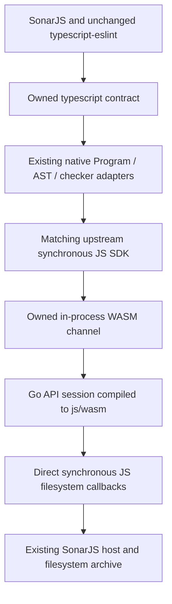

# In-Process WASM Experiment

Date: 2026-10-15. Experimental implementation for JS-2643; not an upstream-supported
WASM distribution or public Go API.

## Architecture



Select `SONARJS_TYPESCRIPT_BACKEND=wasm` before loading consumers. The compiler
contract, released parser, node mapping and native project cache are unchanged.
There is no native compiler child process, pipe, LSP or MessagePack framing.
Multiple sessions share one Go runtime per Node worker; retained IDE snapshots
continue to work, and closing a session releases its project state.

The bridge calls `api.Session.HandleRequest` directly. A Go build overlay adds
one session constructor in the internal API package so it can reuse upstream's
filesystem callback implementation without modifying the upstream checkout.
The JS SDK and WASM source revisions must match; the build helper checks this.
This is our bridge to unstable internal Go code, not a new official API.

Requests still serialize JSON. Results retain the SDK's JSON/binary formats;
`syscall/js` copies request and response bytes across the JS/WASM boundary.
This does **not** share Go AST objects with JavaScript and is not zero-copy.
Go's `js/wasm` runtime is single-threaded here, unlike the native compiler.
Local syntax/configuration utilities still use private TS6, just as the IPC provider does.

## Build And Run

Requires Node 24, Go 1.27, a clean TypeScript Go checkout, and an immutable matching
JS SDK snapshot. The earlier source-build helper can produce that snapshot after
building the upstream compiler and JS API; see [source-build instructions](pr64823-source-build.md).

The current local checkout/snapshot use source revision
`257e87406c6a8be277cb8cd5ef8d7b458a650390` and Go 1.27.2:

```powershell
$env:SONARJS_GO='C:\Users\victor.diez\sdk\go1.27.2\go\bin\go.exe'
node tools/ts7-benchmark/build-wasm.mjs C:\Users\victor.diez\projects\TypeScript tools/ts7-benchmark/out/pr64823-20261015/base-sdk
$env:SONARJS_TS7_WASM=(Resolve-Path tools/ts7-benchmark/out/wasm).Path
node tools/ts7-benchmark/benchmark.mjs --native-backend wasm --rules all --runs 1 --profile
```

Builds, copied runtime/SDK files and results stay under ignored `out/`; the WASM
binary is approximately 39.8 MB and is not committed. The existing native source
snapshot contains a native executable, but the WASM provider does not spawn it.

For the same compiler revision over IPC:

```powershell
node tools/ts7-benchmark/benchmark.mjs --native-sdk tools/ts7-benchmark/out/pr64823-20261015/base-sdk --rules all --runs 1 --profile
```

Run the production integration tests against WASM:

```powershell
$env:SONARJS_NATIVE_TEST_BACKEND='wasm'
$env:TSX_TSCONFIG_PATH='packages/tsconfig.test.json'
node --import tsx --import ./tools/ts7-benchmark/test-backend.mjs --test packages/analysis/tests/ts7/native.test.ts tools/ts7-benchmark/wasm.test.mjs
node --test tools/ts7-benchmark/benchmark.test.mjs
Remove-Item Env:SONARJS_NATIVE_TEST_BACKEND
```

## Validation And Measurements

- Fixture: 2 files, 11 identical rule/file/line findings with all rules.
- Ag-grid: 157 files, 6,524 identical findings, matching source hashes/file lists/active rules.
- All 11 production native integration tests pass with WASM selected, including
  released-parser node maps, IDE snapshots/dependency edits, filesystem notifications,
  custom compiler-host callbacks, cache eviction and explicit unsupported-operation failures.
- Channel tests cover arbitrary binary bytes, independent sessions, timing/reset,
  request errors and idempotent closure. No native child process is present.
- The benchmark archive record/replay integration test passes with WASM, including
  optional profiling, S125 fragments, type-dependent and deprecation findings.
- Source compilation passes. This is not exhaustive scanner/framework/API validation.
- The 30 default TS6/native module integration tests and bridge bundling also pass.

Single profiled ag-grid runs, **not** a controlled performance study:

| Metric                                | Native IPC | In-Process WASM |
| ------------------------------------- | ---------: | --------------: |
| Analysis                              |    20.58 s |         32.37 s |
| Program creation                      |     0.30 s |          1.04 s |
| Parse                                 |     1.88 s |          2.61 s |
| Lint                                  |    18.28 s |         28.58 s |
| API requests                          |     23,728 |          23,728 |
| API round-trip total                  |     3.78 s |         11.24 s |
| Go handler time                       |     1.46 s |          6.93 s |
| Remaining boundary/serialization time |     2.32 s |          4.31 s |

Both use the exact source revision above. The original WASM run took 31.96 s;
the rerun with Go handler timing enabled took 32.37 s. TS6 in the surrounding
pairs ranged from 14.28 to 20.74 s, illustrating environmental variation;
some validation jobs overlapped. Do not treat these as speedup/regression ratios
or compare them directly with older nightly runs.

The new `compilerInitializationMs` reports backend initialization separately;
the timed WASM rerun measured 0.42 s. Analysis time does not include that startup
or all worker/module-loading overhead. RSS for WASM includes the Go heap inside
Node; a zero child-process RSS is **not** zero compiler memory.

WASM timing uses the same SDK result schema, whose legacy field names still say
`ipc`/`transportOverheadMs`. The report explicitly identifies `in-process-wasm`;
the remainder includes serialization/copying/JS-WASM crossings, not IPC latency.
Go background timers are unreferenced in the pinned runtime shim so they do not
own Node's process lifetime. They are not cancelled; an active server still runs them.

Evidence under `tools/ts7-benchmark/out/`: `wasm-ag-grid-final/`,
`wasm-matched-ipc/`, `wasm-native-tests.log`, `wasm-channel-archive-tests.log`,
`wasm-final-tests.log`, and `wasm-compile.log`.

## Assessment

This proves the contract can host a real WASM compiler without changing rules or
forking typescript-eslint. It does **not** currently solve performance parity.
The native Go handlers execute faster in these measurements, and this initial
WASM bridge retains serialization and many crossings. Removing those costs would
require a different low-level bridge/representation and fresh measurements;
simply compiling the IPC API to WASM is insufficient.

Standalone bridge packaging, content-mapper subprocess execution, arbitrary
asynchronous host callbacks, memory64/threaded WASM and complete SDK compatibility
are not implemented. The supported contract remains synchronous; do not switch
backends while compiler objects are alive.
